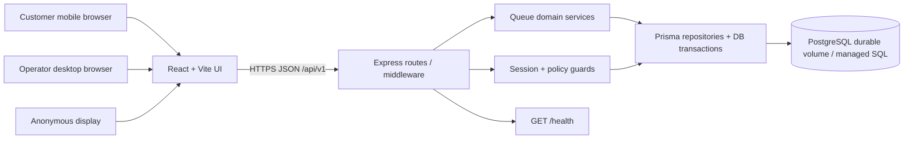
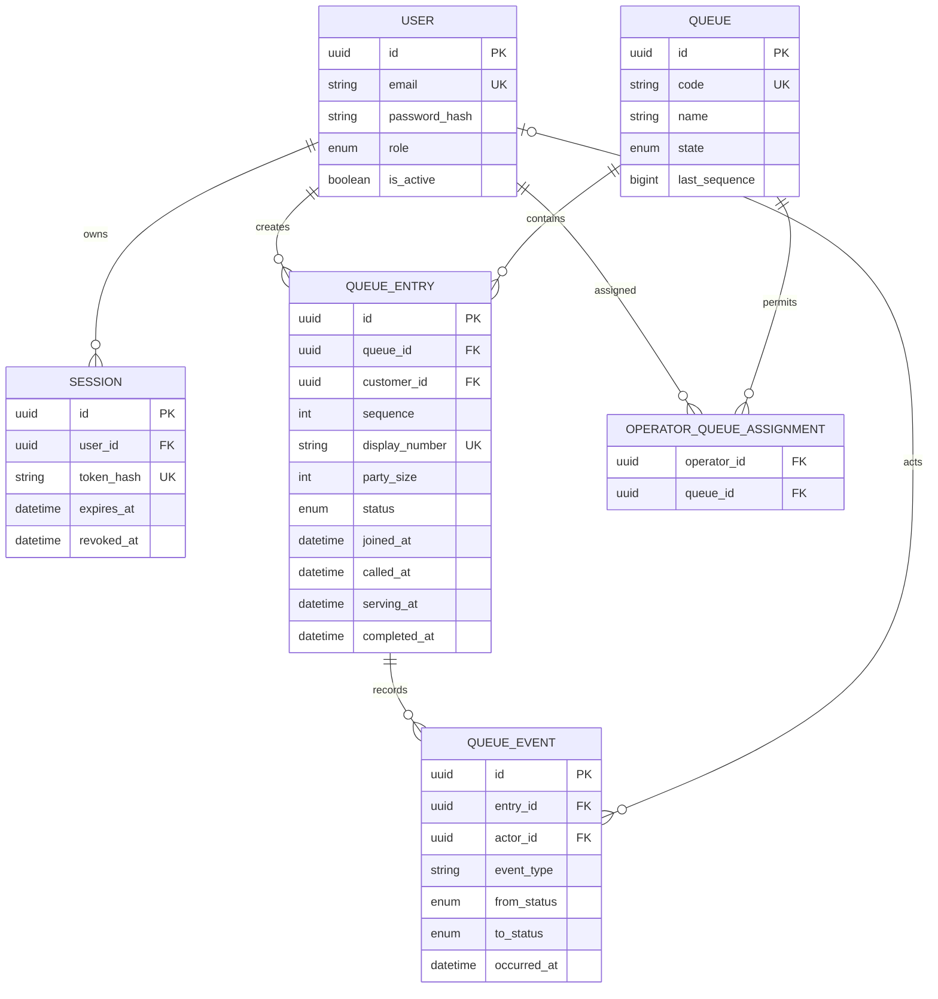
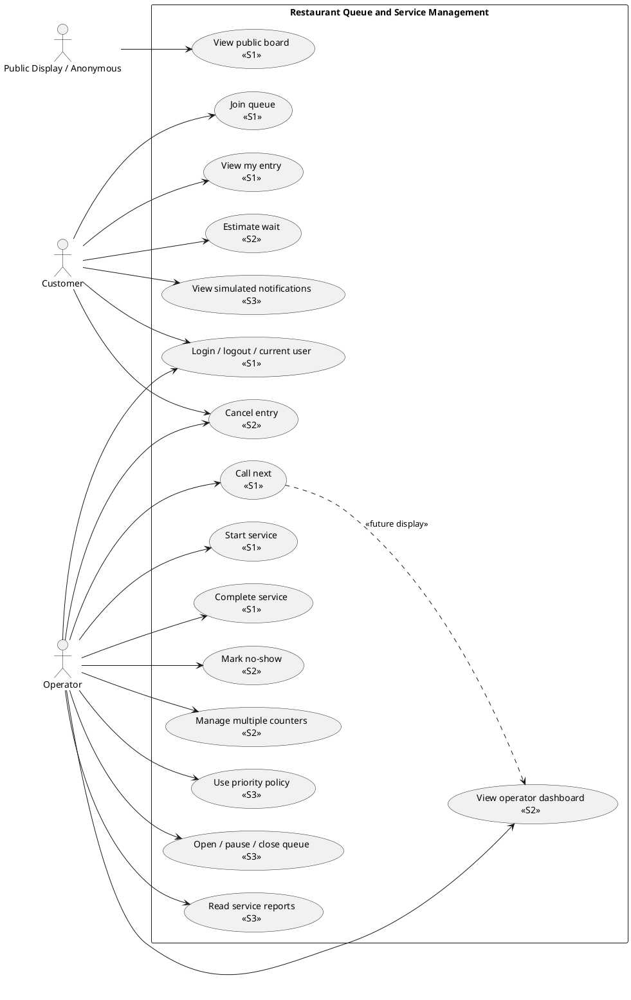
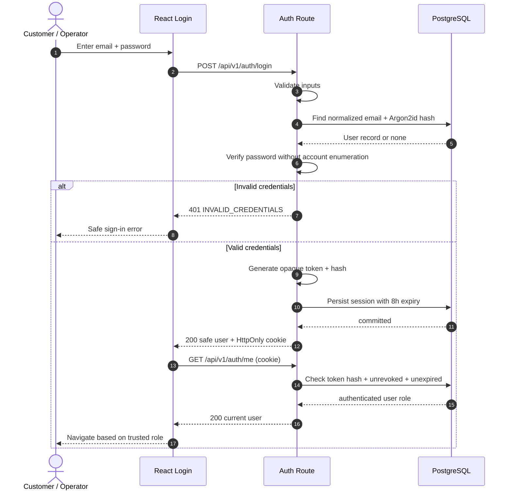
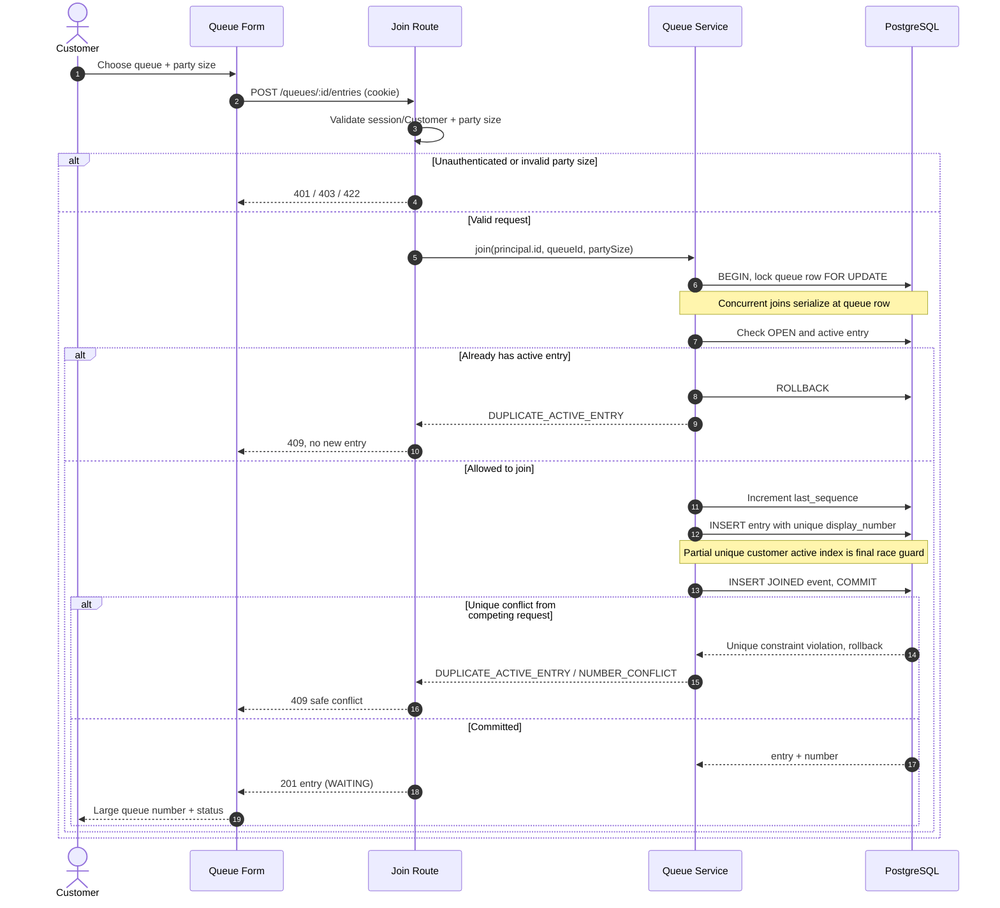
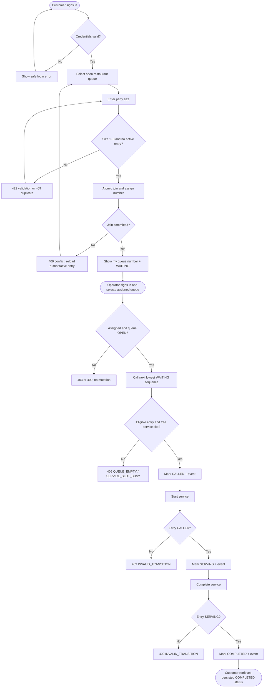
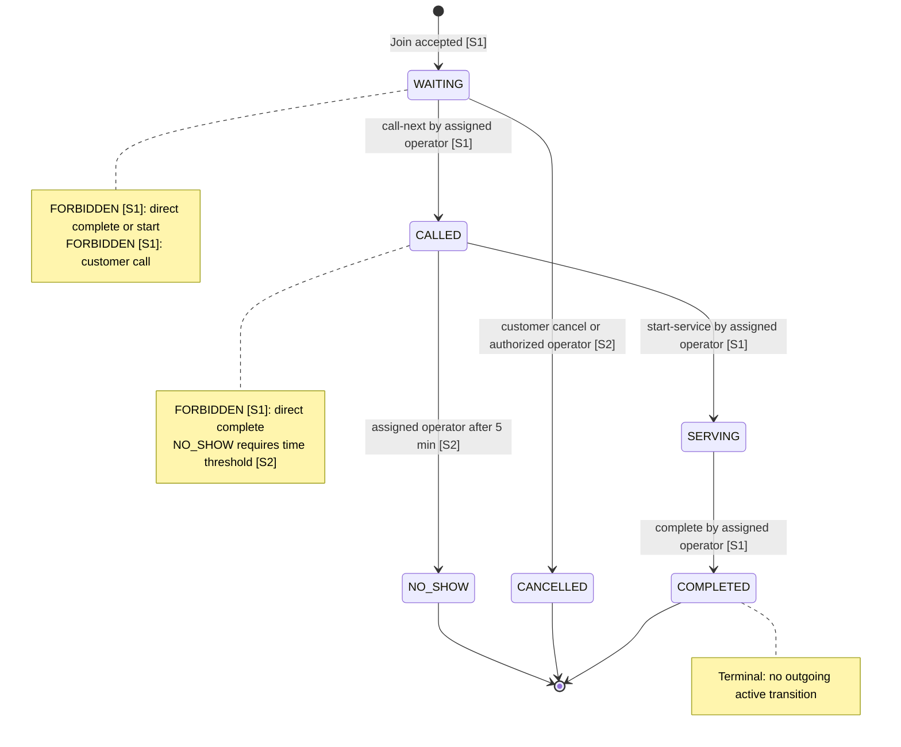

# specification.md — Product and System Engineering Specification

> **Status:** PROPOSED engineering baseline, 6 November 2026. Design and contracts only. No application code, test runs, GitHub releases or deployments are represented as complete. All examples use synthetic placeholders.

> **Companion files:** [specification.md](specification.md) · [api-spec.md](api-spec.md) · [tests.md](tests.md) · [ui-spec.md](ui-spec.md).


## Team-approved Issue 08 scope revision — 7 November 2026

The team explicitly approved party-size routing and two independent queues in Sprint 1. This revision supersedes the original one-queue seed, Operator B's empty assignment list, and the exclusive Sprint 2 allocation of multiple queues. Other baseline decisions retain their existing status; this approval is not a claim that implementation or tests have passed.

| Queue | Accepted party size for new joins | Seed assignment | Service capacity |
| --- | --- | --- | --- |
| R | 1–4 | Operator A only | One CALLED or SERVING entry |
| S | 5–8 | Operator B only | One CALLED or SERVING entry |

Each queue has independent immutable sequence allocation, FIFO and queue-row locking. One active entry per customer across all queues remains mandatory. Existing historical entries, including parties outside the new range for their historical queue, are preserved and may finish the existing lifecycle. No historical rerouting or renumbering is permitted. New queues start OPEN; rerunning seed preserves existing queue state and counters, users, password hashes, sessions, entries and events. Seed inserts missing approved assignments and fails safely on contradictory seeded-operator assignments instead of deleting existing assignments. Multiple counters within a queue remain Sprint 2; registration and administrator management remain excluded.

### Affected requirements and regression map

| Contract area | Affected identifiers/rules | Approved change / regression obligation |
| --- | --- | --- |
| Decisions and scope | D-03, D-20; FR-04–06, FR-08, FR-16; F-02–05 and F-09; Sprint 1/2 scope and traceability | R/S routing is Sprint 1; multiple counters remain Sprint 2. D-01/02/04–09/14/18/26/28 and BR-01–08/11/15–17/26–28 remain enforced per queue or across customers as originally specified. |
| Acceptance and tests | AC/TEST-009–011, 015–024, 028–031, 032–044; TEST-045–049 | Seed two queues/two assignments; cover boundaries 1/4 on R and 5/8 on S; retain role, ownership, FIFO, terminal, audit and concurrency checks on both queues. TEST-039 still checks B forbidden from R and now also A forbidden from S. TEST-043 covers both operator journeys. Historical test evidence remains historical. |
| HTTP | GET /queues; POST /queues/:queueId/entries; GET /operator/queues; desk and three service actions; GET /public/queues/:queueId/board | Preserve paths and envelopes. Validate party-size/queue match on backend; mismatch is 422 VALIDATION_ERROR with details.fields.partySize and no writes. Only R/S accept new joins. Existing queues/history remain stored. A lists R; B lists S; a separately unassigned operator lists []. |
| Customer UI | /queues, QueueJoinForm, /my-queue | Party size determines displayed queue; remove arbitrary selection for new joins, explain both ranges, disable joining if the matching queue is unavailable, preserve status/history/refresh. |
| Operator UI | /operator/desk, Assigned queues, ActiveServiceCard | Show server assignments only, Active: 0/1 or Active: 1/1, independent waiting and service states, existing actions and responsive behavior. |
| Public UI | /board, /board/:queueId, PublicQueueBoard | /board shows R and S using two existing four-field board responses; /board/R and /board/S and UUID links remain supported. No private data or operator controls; independent loading/error/empty/refresh and visibility-aware polling. |
| Verification | NFR-01/04–06/09–10/12–13/15 | Real PostgreSQL simultaneous calls: one winner per queue; R lock cannot block S; success exactly one event per transition, rejection leaves full DB state unchanged. Authentication and existing regression coverage retained. |


## Document coverage

Phase 0 decisions; Part A SRS; Part B feature inventory and traceability; Part C architecture and data model; Part D sprint plan; Phase 4 diagrams; Part E per-feature behavior, acceptance criteria and DoD; Phase 6 GitHub workflow. Sprint 1 interface request/response details live in `api-spec.md`, test details in `tests.md`, and screen behavior in `ui-spec.md`.

## Phase 0 decisions

Status: **PROPOSED baseline v0.1; subject to team and TA approval**. Review each decision before implementing its dependent feature. Source: CPE 334 Group Work Specification, pp. 3–4, 8–11, and Deliverable 1, pp. 1–4. These are project interpretations, not instructor-mandated policies.

| ID | Decision | Rationale / consequence |
| --- | --- | --- |
| D-01 | FIFO per queue, ordered by immutable database sequence ascending. | Simple deterministic restaurant waiting line; later priority policy is a versioned change. |
| D-02 | Eligible for `call-next` means status `WAITING` in a queue with state `OPEN`, with no entry already `CALLED` or `SERVING`. | Prevent skip and double calls. |
| D-03 | `partySize` integer 1–8 inclusive; new joins of 1–4 use R, 5–8 use S; reject a mismatched requested queue. | Initial small restaurant demonstration; 1 and 8 are boundary cases. |
| D-04 | At most one active entry (`WAITING`, `CALLED`, `SERVING`) per customer across the restaurant. | Enforce with a database partial unique index, not a UI check. |
| D-05 | Display number format `QUEUECODE-NNNN` with minimum four digits, e.g. `R-0001`; unique queue code, no artificial maximum at 9999. | Human readable and globally unique when paired with unique queue code. |
| D-06 | Sequence monotonically increases per queue; never resets in Sprint 1. | Avoid timezone and daily rollover races. |
| D-07 | One active service position per queue in Sprint 1. Only one `CALLED` or `SERVING` entry per queue. | Allows a clear operator workflow; F-09 revisits multi-counter behavior. |
| D-08 | Join, number allocation, state change, and event insert are in one database transaction; concurrent callers serialize on the queue row. | Prevent races, partial writes and contradictory histories. |
| D-09 | An `OPERATOR` can operate only queues referenced by `OperatorQueueAssignment`. | Required server-enforced scope. |
| D-10 | A `CUSTOMER` may read only own detailed entries. Foreign entry IDs return generic 404 (non-leaking). | Avoid object-level authorization leaks. |
| D-11 | Anonymous board exposes queue code, currently called public number and public state, and aggregate waiting count only. No name, customer ID, party size, private timestamp or entry ID. | Enables anonymous display without disclosure. |
| D-12 | Opaque random session token in HttpOnly cookie, 8-hour absolute lifetime, token hash stored in DB; logout revokes session immediately. | Reliable server-side invalidation and testable expiry. |
| D-13 | Argon2id password hashes, seeded fake accounts, identical error for unknown user/wrong password. | No plaintext; no account enumeration. |
| D-14 | Required Sprint 1 sequence: `WAITING → CALLED → SERVING → COMPLETED`; an explicit `start-service` operation is required. | Demonstrates serving as a real lifecycle stage. |
| D-15 | In Sprint 2 customer can cancel own `WAITING` entry; assigned operator may cancel a `WAITING` entry with a recorded reason. Neither can cancel after `CALLED` in the initial policy. | Keep cancellation outside Sprint 1 while reserving lifecycle branch. |
| D-16 | In Sprint 2, assigned operator may mark `CALLED → NO_SHOW` no sooner than five minutes after call. | Concrete threshold; clock injection for boundary tests. |
| D-17 | F-11 later introduces priority only after documented rule and regression revision. | Existing FIFO remains authoritative until then. |
| D-18 | Store timestamps in UTC; display in Asia/Bangkok; create a history record for each accepted join or transition. | Traceability and correct reports. |
| D-19 | Queue starts `OPEN`; F-12 adds `PAUSED` and `CLOSED`. Pause/close block join and new calls; already active `SERVING` may finish. | Separate queue lifecycle from entry lifecycle. |
| D-20 | Seed OPEN queues R (1–4, Operator A) and S (5–8, Operator B), plus two customers; each operator is assigned only its designated queue. | Feasible Sprint 1 demonstration of ownership and assignment. |
| D-21 | API uses `/api/v1`, JSON, UTC ISO timestamps, stable machine-readable error codes, and no raw stack traces. | Predictable client and tests. |
| D-22 | Same-origin UI/API deployment; `SameSite=Lax`, `HttpOnly`, production `Secure` cookie; reject disallowed `Origin` for unsafe cookie-authenticated requests. | Practical cookie and CSRF baseline. |
| D-23 | No customer self-registration in Sprint 1, no booking, table allocation, payments, real SMS/email, or push delivery. | Keep focus on queue workflow. |
| D-24 | Client polls the board/my status at 10-second intervals while visible; server remains authoritative; no WebSockets in Sprint 1. | Avoid unrelated realtime infrastructure. |
| D-25 | API returns 404 for foreign private entry, 403 for authorized-role users lacking permission on an existing queue; never expose private resource details in errors. | Stable authorization semantics. |
| D-26 | Start with one logical counter per queue, without a `Counter` table in Sprint 1; F-09 introduces persisted counters and counter assignments through a versioned migration. | Avoid speculative complexity while preserving extensibility. |
| D-27 | No customer edits to party size after joining in Sprint 1; cancel and rejoin becomes possible in Sprint 2. | Prevent reorder/identity ambiguity. |
| D-28 | Historical queue entries never deleted by normal users; terminal states immutable. | Supports reporting and audit consistency. |

## Open, nonblocking questions for team / TA

1. Is the restaurant happy with FIFO and the one-active-entry-per-customer policy across queues? If not, revise D-01/D-04 before implementation.
2. Is party size 1–8 appropriate for the chosen restaurant? If not, update D-03 plus its boundary tests before implementation.
3. Should no-show be operator-confirmed after five minutes or automatic? D-16 currently specifies manual confirmation.
4. When introducing multiple counters, can operators work several queues concurrently? D-09 permits several assignments; D-07 prevents multiple active services *within one queue* in Sprint 1.

**Blocking questions:** none for the proposed Sprint 1 baseline. Record acceptance/revision in a decision Issue or reviewed documentation PR. No code has been written, no tests have been executed.

## Part A SRS

**Product:** Restaurant Queue and Service Management System (Theme 9)  
**Course:** CPE 334, semester 1/2026  
**Baseline:** v0.1 PROPOSED, 6 November 2026  
**Authority:** Group Work Specification pp. 3–4, 8–11 and Deliverable 1 pp. 1–4. Restaurant-specific thresholds and detailed mechanisms are proposed team decisions in [Phase 0 decisions](specification.md), not teacher-specified requirements.

## Stakeholder problem and product goal

Restaurant guests need a clear place in a waiting line without asking staff repeatedly. Hosts must call guests in the agreed order, accurately record when service begins and ends, and prevent duplicate tickets, skipped customers, conflicting calls, and access to private queue information. Provide a small, usable, persistent restaurant queue application, with a browser UI, REST API, and PostgreSQL, then extend the same codebase through three sprints.

## Actors and stakeholders

| Actor | Needs and responsibility |
| --- | --- |
| Customer | Sign in; join restaurant queue with party size; see own number and lifecycle status; later cancel when eligible. |
| Operator (host) | Sign in; see assigned queues; call oldest eligible guest; mark service begun and completed; later handle no-shows and counters. |
| Public display / anonymous viewer | Read only deliberately public non-private queue status. Not a login role. |
| Restaurant manager (stakeholder, not Sprint 1 login role) | Wants safe workflow, reliable wait times and service summaries in later sprints. |
| Developer / TA | Need reproducible setup, testable rules, evidence, future Docker/GCP support. |

## In scope

Authentication, seeded users and assignment, joining, customer entry view, anonymous board, controlled call/start/complete workflow, immutable audit history and persistence in Sprint 1. Cancellation, no-show, dashboard, multiple counters per queue, ETA, priority, queue availability policy, reporting and simulated notifications are planned subsequently.

## Explicit exclusions

Advance table reservations/appointments, table map or table allocation, point-of-sale, real payments, SMS/email delivery, self-registration, password recovery, multi-tenant restaurant administration, full staff management, kitchen inventory and external APIs. No customer contact details appear on a public board.

## Assumptions and decisions

D-01 through D-28 in [Phase 0 decisions](specification.md) govern default rules. They must be discussed and versioned if changed. Initial data includes OPEN queues R and S, two customers, Operator A assigned only R and Operator B assigned only S. The operational timezone is Asia/Bangkok; timestamps are stored UTC.

## Functional requirements

| ID | Testable system behavior | Sprint |
| --- | --- | --- |
| FR-01 | Authenticate seeded users, return current identity, and revoke session on logout. | 1 |
| FR-02 | Enforce `CUSTOMER` / `OPERATOR` permissions on backend for every protected route. | 1 |
| FR-03 | Persist operator-to-queue assignments and restrict operations to assigned queues. | 1 |
| FR-04 | Reproducibly seed demo accounts, two restaurant queues R/S and their designated assignments. | 1 |
| FR-05 | Let an authenticated customer join an `OPEN` queue with a validated party size. | 1 |
| FR-06 | Allocate a unique human-readable queue number and prevent a second active customer entry. | 1 |
| FR-07 | Let a customer retrieve their own latest/current detailed queue entry and status. | 1 |
| FR-08 | Supply a public queue board response with explicitly whitelisted, non-private information. | 1 |
| FR-09 | Allow an authorized operator to call the oldest eligible `WAITING` entry. | 1 |
| FR-10 | Allow an authorized operator to start service for a `CALLED` entry. | 1 |
| FR-11 | Allow an authorized operator to complete a `SERVING` entry. | 1 |
| FR-12 | Persist entry lifecycle timestamps and transition audit events. | 1 |
| FR-13 | Let a customer/operator cancel eligible entries, following role-specific rules. | 2 |
| FR-14 | Let an assigned operator mark a sufficiently overdue `CALLED` entry as no-show. | 2 |
| FR-15 | Provide a useful assigned-queue operator dashboard. | 2 |
| FR-16 | Support R/S independent queues in Sprint 1; multiple service counters with correct scoped assignment remain Sprint 2. | 1 (queues), 2 (counters) |
| FR-17 | Display a labelled estimated wait time from documented historical/queue data. | 2 |
| FR-18 | Allow a documented, configurable priority policy. | 3 |
| FR-19 | Allow authorized pause/open/close of queues with enforced operations policy. | 3 |
| FR-20 | Provide aggregate service summaries by date, queue and status. | 3 |
| FR-21 | Show simulated notification events without sending external messages. | 3 |
| FR-22 | Provide safe validation, empty/loading/error states, conflict recovery and resilient operations. | 1–3 |
| FR-23 | Provide an unauthenticated `GET /health` endpoint exposing service health, not secrets. | 1 |
| FR-24 | Provide reproducible DB migrations/seed and durable persisted data. | 1 |

## Business rules

| ID | Testable invariant / policy | Sprint |
| --- | --- | --- |
| BR-01 | Ordinary queue service order is FIFO by assigned `sequence` ascending. | 1 |
| BR-02 | Only `WAITING` entries are eligible to call and only when queue is `OPEN` and no active service exists. | 1 |
| BR-03 | Party size must be an integer between 1 and 8 inclusive; new joins require R for 1–4 and S for 5–8. | 1 |
| BR-04 | Each customer has at most one `WAITING`, `CALLED`, or `SERVING` entry across all queues. | 1 |
| BR-05 | Every entry has unique queue-scoped sequence and globally unique formatted `displayNumber`. | 1 |
| BR-06 | Join and call are rejected when the queue is not `OPEN`. | 1 (OPEN only); 3 (other states) |
| BR-07 | A queue has at most one `CALLED` or `SERVING` entry in Sprint 1. | 1 |
| BR-08 | Sprint 1 legal chain is `WAITING → CALLED → SERVING → COMPLETED` only. | 1 |
| BR-09 | Customers cannot call, start or complete service, regardless of frontend visibility. | 1 |
| BR-10 | A customer cannot see another customer's private entry; foreign entry ID returns 404 without details. | 1 |
| BR-11 | An operator may inspect or change private queue entries only when assigned that queue. | 1 |
| BR-12 | Anonymous board never returns names, IDs, party sizes, email, private timestamps or complete entry records. | 1 |
| BR-13 | Revoked/expired sessions fail protected calls; unknown account and wrong password receive the same safe error. | 1 |
| BR-14 | Account passwords are hashed using Argon2id, never saved or logged as plaintext. | 1 |
| BR-15 | Join/number allocation and duplicate-active invariant hold under simultaneous HTTP requests. | 1 |
| BR-16 | Simultaneous operator call requests cannot call two entries or skip the FIFO head. | 1 |
| BR-17 | Successful creation and every permitted status transition produce a durable history event. | 1 |
| BR-18 | Customer cancellation applies only to own `WAITING` entry; assigned operators cancel `WAITING` entries with a reason. | 2 |
| BR-19 | No-show permitted only after 5 minutes in `CALLED` and only for assigned operators. | 2 |
| BR-20 | Each counter may serve at most one entry and a call reserves an available counter. | 2 |
| BR-21 | ETA is labelled an estimate, is nonnegative and never shown as guaranteed service time. | 2 |
| BR-22 | Priority ordering has explicit tie-break and cannot bypass capacity or authorization. | 3 |
| BR-23 | Paused/closed queues reject joins and new calls; in-progress service may complete. | 3 |
| BR-24 | Reports aggregate persisted authorized data, not browser-side guesses. | 3 |
| BR-25 | Notification placeholders create no actual external network message. | 3 |
| BR-26 | `COMPLETED`, `CANCELLED` and `NO_SHOW` are terminal states and cannot reenter active flow. | 1 (COMPLETED); 2 (other terminal states) |
| BR-27 | The server derives `customerId` from session, not a client-supplied identity. | 1 |
| BR-28 | An operator may not manage a queue merely by guessing/changing a queue ID. | 1 |

## Measurable nonfunctional requirements

| ID | Target and boundary | Verification | Sprint |
| --- | --- | --- | --- |
| NFR-01 | 100% of protected API endpoints reject anonymous requests (401), disallowed roles (403), and private cross-customer access (404). | API integration authorization matrix, including direct HTTP bypass of UI. | 1 |
| NFR-02 | Session expiry at 8 h absolute; logout immediately invalidates token even if cookie is replayed. | Clock-controlled session/API tests. | 1 |
| NFR-03 | No plaintext password persisted or logged; stored hashes verify with Argon2id. | Seed DB inspection and auth integration test. | 1 |
| NFR-04 | Public board JSON includes only allowlisted fields; zero private fields in serialized response. | Response-shape/security test. | 1 |
| NFR-05 | For 20 concurrent join attempts by one user: at most one active entry; for parallel unique customers: all allocated numbers distinct. For simultaneous calls: at most one in active service per queue. | Real PostgreSQL concurrent API integration tests. | 1 |
| NFR-06 | Migrations/seed repeat cleanly and saved entry remains after API restart (same durable DB). | Fresh DB setup, rerun seed, restart/retrieve test. | 1 |
| NFR-07 | `GET /health` returns 200 and `{status:"ok"}` when app ready, no secrets/credentials. | HTTP smoke test, including before login. | 1 |
| NFR-08 | p95 API latency ≤ 800 ms for join/read/call under 20 concurrent simulated users and 1,000 historical entries on a documented reference environment; no correctness violations. | Load script with tool, dataset and hardware recorded. | 3 |
| NFR-09 | At 360 px wide, customer flow has no horizontal scroll; all principal controls ≥ 44×44 CSS px. | Playwright viewport checks and manual mobile review. | 1 |
| NFR-10 | User-facing text contrast at least 4.5:1 for normal text and 3:1 for large text; 3:1 for essential graphical controls. Keyboard operable, visible focus and form errors linked to fields. | Token contrast calculations and accessibility checks. | 1–3 |
| NFR-11 | No committed production secrets; all deploy-specific values from documented environment variables. | Git diff/repo scan, example env file review. | 1, Lab 5 |
| NFR-12 | All BR-01–BR-17 and key access cases have linked planned automated tests; no required tests silently skipped. | AC→TEST review and actual runner output. | 1 |
| NFR-13 | Every accepted lifecycle transition retains actor, type, timestamp and entry; errors omit secret data. | Event table integration assertions and log review. | 1 |
| NFR-14 | Application can be containerized, deploys via main release pipeline and retains DB state across redeploy. | Docker/GCP deployment and restart check. | Lab 5 |
| NFR-15 | After conflict, client displays an actionable safe error and refreshes authoritative state; no duplicate action from accidental double submit. | E2E conflict/slow-response checks and regression. | 1–3 |

## Quality, limitations and change control

Sprint 1 is complete only when real UI → API → PostgreSQL behavior, authentication, authorization, a normal customer/operator journey, invalid cases and evidence are confirmed on a named release commit. Tests are **planned, not yet run**. Docker, CI/CD and actual GCP provisioning are Lab 5 deliverables, not required in Deliverable 1. Before any FR/BR/NFR change, update its decision, feature, AC/TEST coverage and PR description; do not silently reduce scope.

## Part B feature inventory

**Status:** Planned. `F-01` through `F-14` are retained as requested; F-05 title is expanded to include the mandatory `SERVING` stage. All requirements are allocated in [traceability matrix](specification.md). Cross-cutting delivery responsibilities appear separately below.

| Feature | Description | Key FR | Key BR | Key NFR | Depends on | Sprint |
| --- | --- | --- | --- | --- | --- | --- |
| F-01 | Login, logout, current user and session lifecycle. | FR-01 | BR-13, BR-14 | NFR-01, 02, 03 | DB + seed | 1 |
| F-02 | Role/queue authorization; operator assignments; reproducible seed and health foundation. | FR-02–04, 23–24 | BR-09–11, 27–28 | NFR-01, 06, 07, 11 | F-01, schema | 1 |
| F-03 | Customer join, party size validation, unique number and duplicate prevention. | FR-05–06 | BR-03–06, 15, 27 | NFR-05, 06 | F-01, F-02 | 1 |
| F-04 | My queue detail and anonymous privacy-safe queue board. | FR-07–08 | BR-10, 12 | NFR-04, 09, 10 | F-01–03 | 1 |
| F-05 | Authorized call-next, start service, complete and audit lifecycle. | FR-09–12 | BR-01–02, 07–08, 16–17, 26, 28 | NFR-05, 12, 13 | F-01–04 | 1 |
| F-06 | Customer/operator cancellation with reason and permission rules. | FR-13 | BR-18, 26 | NFR-01, 13 | F-05 | 2 |
| F-07 | Timed manual no-show handling. | FR-14 | BR-19, 26 | NFR-01, 13 | F-05 | 2 |
| F-08 | Operator dashboard for assigned queue statuses and safe controls. | FR-15, 22 | BR-11, 28 | NFR-09, 15 | F-05–07 | 2 |
| F-09 | Multiple counters per queue with counter occupancy and scoped access; independent R/S queues already exist in Sprint 1. | FR-16 | BR-20, 28 | NFR-05, 06 | F-02, F-05 | 2 |
| F-10 | Approximate waiting time, explained and bounded. | FR-17 | BR-21 | NFR-08 | F-05, F-09 | 2 |
| F-11 | Explicit priority queue policy and audited rule revision. | FR-18 | BR-22 | NFR-05, 12 | F-05, F-09 | 3 |
| F-12 | Operator queue open, pause, close with state guards. | FR-19 | BR-06, 23 | NFR-01, 15 | F-09 | 3 |
| F-13 | Service summaries, filters and aggregate reports. | FR-20 | BR-24 | NFR-08, 13 | F-05–12 | 3 |
| F-14 | Simulated notification placeholder with no external messaging. | FR-21 | BR-25 | NFR-15 | F-05, F-07 | 3 |

## Engineering responsibilities outside end-user feature IDs

| Responsibility | Ownership | Sprint / checkpoint |
| --- | --- | --- |
| XR-01 | Shared safe API conventions, validation, error/empty/loading UX, responsive design and accessibility. | Foundation 1; regressions 2–3 |
| XR-02 | Automated unit/API/UI/E2E tests, AC/TEST mapping and meaningful TDD history. | Every sprint |
| XR-03 | GitHub Issues/board, feature branches, reviewed PRs, sprint staging/main release and tags. | Every sprint |
| XR-04 | Env isolation, health check, migrations, seed, restart proof, no committed secrets. | Foundation 1; deployment Lab 5 |
| XR-05 | Containerization, required CI gate, GCP and release deployment. | Lab 5 and maintained afterward |
| XR-06 | Independent UAT, defect reports, fix + retest. | Lab 6 |
| XR-07 | Instructor-approved maintenance change, changed failing test, regression and metrics. | Lab 7 |
| XR-08 | Final integrated hardening, usability/security regression and demo. | Sprint 3 and final |

**Scope gap resolved:** the original plan omitted an explicit `start service` transition and permanent history; both are now included in F-05. Multiple counters and prioritization deliberately stay in later sprints. Advance table booking remains excluded.

## Part B requirement traceability

**Status:** Planned, not verified. `AC` and `TEST` identifiers are Sprint 1 plans, not pass claims. Later-sprint rows have their sprint allocated but AC/TEST are intentionally unassigned until feature contracts are written. `Lab 5` means deployment assessment, not product Sprint 5.

| Requirement | Feature / responsibility | Allocation | AC | Test | Evidence status |
| --- | --- | --- | --- | --- | --- |
| FR-01 | F-01 | Sprint 1 | AC-001 | TEST-001 | Planned / not executed |
| FR-02 | F-02 | Sprint 1 | AC-012 | TEST-012 | Planned / not executed |
| FR-03 | F-02 | Sprint 1 | AC-010 | TEST-010 | Planned / not executed |
| FR-04 | F-02 | Sprint 1 | AC-009 | TEST-009 | Planned / not executed |
| FR-05 | F-03 | Sprint 1 | AC-016 | TEST-016 | Planned / not executed |
| FR-06 | F-03 | Sprint 1 | AC-021 | TEST-021 | Planned / not executed |
| FR-07 | F-04 | Sprint 1 | AC-025 | TEST-025 | Planned / not executed |
| FR-08 | F-04 | Sprint 1 | AC-028 | TEST-028 | Planned / not executed |
| FR-09 | F-05 | Sprint 1 | AC-032 | TEST-032 | Planned / not executed |
| FR-10 | F-05 | Sprint 1 | AC-035 | TEST-035 | Planned / not executed |
| FR-11 | F-05 | Sprint 1 | AC-036 | TEST-036 | Planned / not executed |
| FR-12 | F-05 | Sprint 1 | AC-041 | TEST-041 | Planned / not executed |
| FR-13 | F-06 | Sprint 2 | Pending contract | Pending contract | Planned / not executed |
| FR-14 | F-07 | Sprint 2 | Pending contract | Pending contract | Planned / not executed |
| FR-15 | F-08 | Sprint 2 | Pending contract | Pending contract | Planned / not executed |
| FR-16 | F-02–05 (R/S queues); F-09 (counters) | Sprint 1 queues; Sprint 2 counters | AC-009–011, 017, 040, 043 | TEST-009–011, 017, 040, 043; TEST-052–057 | Revised scope; verification required |
| FR-17 | F-10 | Sprint 2 | Pending contract | Pending contract | Planned / not executed |
| FR-18 | F-11 | Sprint 3 | Pending contract | Pending contract | Planned / not executed |
| FR-19 | F-12 | Sprint 3 | Pending contract | Pending contract | Planned / not executed |
| FR-20 | F-13 | Sprint 3 | Pending contract | Pending contract | Planned / not executed |
| FR-21 | F-14 | Sprint 3 | Pending contract | Pending contract | Planned / not executed |
| FR-22 | F-04; F-08; XR-01 | Sprint 1 | AC-030 | TEST-030 | Planned / not executed |
| FR-23 | F-02; XR-04 | Sprint 1 | AC-014 | TEST-014 | Planned / not executed |
| FR-24 | F-02; XR-04 | Sprint 1 | AC-015 | TEST-015 | Planned / not executed |
| BR-01 | F-05 | Sprint 1 | AC-032 | TEST-032 | Planned / not executed |
| BR-02 | F-05 | Sprint 1 | AC-032 | TEST-032 | Planned / not executed |
| BR-03 | F-03 | Sprint 1 | AC-018 | TEST-018 | Planned / not executed |
| BR-04 | F-03 | Sprint 1 | AC-019 | TEST-019 | Planned / not executed |
| BR-05 | F-03 | Sprint 1 | AC-021 | TEST-021 | Planned / not executed |
| BR-06 | F-03; F-05; F-12 | Sprint 1 | AC-022; AC-044 | TEST-022; TEST-044 | Planned / not executed |
| BR-07 | F-05 | Sprint 1 | AC-034 | TEST-034 | Planned / not executed |
| BR-08 | F-05 | Sprint 1 | AC-037 | TEST-037 | Planned / not executed |
| BR-09 | F-05; F-02 | Sprint 1 | AC-038 | TEST-038 | Planned / not executed |
| BR-10 | F-04 | Sprint 1 | AC-026 | TEST-026 | Planned / not executed |
| BR-11 | F-02; F-05 | Sprint 1 | AC-011 | TEST-011 | Planned / not executed |
| BR-12 | F-04 | Sprint 1 | AC-028 | TEST-028 | Planned / not executed |
| BR-13 | F-01 | Sprint 1 | AC-004 | TEST-004 | Planned / not executed |
| BR-14 | F-01 | Sprint 1 | AC-002 | TEST-002 | Planned / not executed |
| BR-15 | F-03 | Sprint 1 | AC-020 | TEST-020 | Planned / not executed |
| BR-16 | F-05 | Sprint 1 | AC-040 | TEST-040 | Planned / not executed |
| BR-17 | F-05 | Sprint 1 | AC-041 | TEST-041 | Planned / not executed |
| BR-18 | F-06 | Sprint 2 | Pending contract | Pending contract | Planned / not executed |
| BR-19 | F-07 | Sprint 2 | Pending contract | Pending contract | Planned / not executed |
| BR-20 | F-09 | Sprint 2 | Pending contract | Pending contract | Planned / not executed |
| BR-21 | F-10 | Sprint 2 | Pending contract | Pending contract | Planned / not executed |
| BR-22 | F-11 | Sprint 3 | Pending contract | Pending contract | Planned / not executed |
| BR-23 | F-12 | Sprint 3 | Pending contract | Pending contract | Planned / not executed |
| BR-24 | F-13 | Sprint 3 | Pending contract | Pending contract | Planned / not executed |
| BR-25 | F-14 | Sprint 3 | Pending contract | Pending contract | Planned / not executed |
| BR-26 | F-05; F-06; F-07 | Sprint 1 | AC-042 | TEST-042 | Planned / not executed |
| BR-27 | F-03 | Sprint 1 | AC-023 | TEST-023 | Planned / not executed |
| BR-28 | F-02; F-05 | Sprint 1 | AC-039 | TEST-039 | Planned / not executed |
| NFR-01 | F-01; F-02; F-04; F-05 | Sprint 1 | AC-005 | TEST-005 | Planned / not executed |
| NFR-02 | F-01 | Sprint 1 | AC-006 | TEST-006 | Planned / not executed |
| NFR-03 | F-01 | Sprint 1 | AC-002 | TEST-002 | Planned / not executed |
| NFR-04 | F-04 | Sprint 1 | AC-028 | TEST-028 | Planned / not executed |
| NFR-05 | F-03; F-05 | Sprint 1 | AC-020 | TEST-020 | Planned / not executed |
| NFR-06 | F-02; F-03 | Sprint 1 | AC-015 | TEST-015 | Planned / not executed |
| NFR-07 | F-02 | Sprint 1 | AC-014 | TEST-014 | Planned / not executed |
| NFR-08 | F-10; F-13; XR-08 | Sprint 3 | Pending contract | Pending contract | Planned / not executed |
| NFR-09 | F-04; XR-01 | Sprint 1 | AC-030 | TEST-030 | Planned / not executed |
| NFR-10 | F-04; XR-01; XR-08 | Sprint 1 | AC-030 | TEST-030 | Planned / not executed |
| NFR-11 | F-02; XR-04 | Sprint 1 | AC-009 | TEST-009 | Planned / not executed |
| NFR-12 | XR-02; F-05 | Sprint 1 | AC-041 | TEST-041 | Planned / not executed |
| NFR-13 | F-05 | Sprint 1 | AC-041 | TEST-041 | Planned / not executed |
| NFR-14 | XR-04; XR-05 | Lab 5 | Pending contract | Pending contract | Planned / not executed |
| NFR-15 | F-04; F-05; XR-01 | Sprint 1 | AC-043 | TEST-043 | Planned / not executed |

## Coverage audit

* FR-01 through FR-24, BR-01 through BR-28, NFR-01 through NFR-15 all have allocated owners. No uncovered baseline ID is intentionally left without an owner.
* NFR-14 is allocated to the Lab 5 infrastructure responsibility and designed for during Sprint 1. Completion cannot be claimed in Deliverable 1.
* BR-06 and BR-26 are staged policies: Sprint 1 implements the relevant subset; their remaining states are checked with F-12 and F-06/F-07.
* AC-001 through AC-044 have defined TEST-001 through TEST-044 plus five extra unit TEST-045 through TEST-049 in `docs/tests.md`; future-sprint tests are not yet claimed or numbered.
* Evidence status must be updated with actual test path, executed command, counts, commit SHA and result only after execution.

## Requirement change policy

If policy changes (e.g. priority before Sprint 3, daily queue-number reset or new cancellation states), update D decision, FR/BR, feature SDS, AC and STS, then review the diff before implementation. Retain previous versions in Git history.

## Part C system design

## Architecture and stack

**Modular monolith**, one Express API and one React client plus PostgreSQL. Reuse Labs 1–4 patterns: React 18, Vite, TypeScript, Bootstrap 5; Node.js, Express, TypeScript, Prisma, PostgreSQL; Vitest, Supertest and Playwright. Avoid a message broker, WebSockets, microservices or speculative cloud dependencies in Sprint 1.



| Component | Responsibility | Explicitly must not do |
| --- | --- | --- |
| React pages/components | Render mobile/desktop screens, client validation, loading/empty/error states, polling, accessibility, route navigation. | Calculate authoritative queue number, role, allowed transitions or FIFO head. |
| Express routes | Parse request, validate payload, attach authenticated principal, map errors, call services. | Embed SQL in UI or trust request-supplied actor identity. |
| Session middleware | Read cookie, hash token lookup, enforce expiration/revocation and roles; restrict Origin for unsafe calls. | Trust client-selected role or userId. |
| Authorization policies | Verify customer entry ownership and operator/queue assignment at every sensitive route. | Assume hiding a button grants protection. |
| Queue service | Implement BR-01–BR-17: FIFO, eligibility, join rules, state transitions, invariant conflict behavior, event creation. | Rely only on preflight reads for race safety. |
| Prisma/data layer | DB schema, FK, indexes, migrations, transactions and row locks. | Produce user-visible errors containing DB diagnostics/secrets. |
| PostgreSQL | Authoritative durable records, unique invariants, atomic commits. | Treat memory or localStorage as source of truth. |

### Modules and naming

Backend proposed modules: `auth`, `users`, `queues`, `entries`, `operator`, `public-board`, `audit`, `infrastructure`. Share `domain/errors`, `authorization`, DB client and request validation utility. Prefer service/repository interfaces that can be tested without mocking the entire backend; use real PostgreSQL for concurrency integration tests.

## Data model / ER diagram



`SERVICE_COUNTER` and a counter-to-entry assignment are scheduled for F-09 in Sprint 2, rather than inventing a second active counter in Sprint 1. Future relationship: one Queue has many Counters; a Counter can own one currently active entry. Sprint 1 has one logical service position per queue.

### Data dictionary and ownership

| Table | Field and type (conceptual SQL) | Constraint / meaning |
| --- | --- | --- |
| `users` | `id UUID`, `email VARCHAR(254)`, `display_name VARCHAR(100)`, `password_hash TEXT`, `role ENUM(CUSTOMER,OPERATOR)`, `is_active BOOLEAN`, `created_at TIMESTAMPTZ` | Primary key; email unique case-insensitively (normalized lowercase before insert); hash mandatory. No customer phone required. |
| `sessions` | `id UUID`, `user_id UUID`, `token_hash CHAR(64)`, `created_at`, `expires_at`, `revoked_at` | PK; user FK; token hash unique; revoked nullable; expiration mandatory; can revoke at logout. Never store raw bearer value. |
| `queues` | `id UUID`, `code VARCHAR(8)`, `name VARCHAR(100)`, `state ENUM(OPEN,PAUSED,CLOSED)`, `last_sequence BIGINT`, `created_at` | PK; code unique, uppercase regex `[A-Z0-9]+`; last_sequence ≥0. Only OPEN used in Sprint 1; other states reserved. |
| `operator_queue_assignments` | `operator_id UUID`, `queue_id UUID`, `created_at` | Composite PK `(operator_id,queue_id)`; FKs; referenced user must have OPERATOR role (enforce in assignment service/seed). |
| `queue_entries` | `id UUID`, `queue_id UUID`, `customer_id UUID`, `sequence BIGINT`, `display_number VARCHAR(32)`, `party_size SMALLINT`, `status ENUM(WAITING,CALLED,SERVING,COMPLETED,CANCELLED,NO_SHOW)`, `joined_at`, `called_at`, `serving_at`, `completed_at`, `cancelled_at`, `no_show_at`, `updated_at` | PK; queue/customer FKs; unique `(queue_id,sequence)`; unique `display_number`; check `1≤party_size≤8`; lifecycle timestamps nullable until reached; entry owner is customer_id. |
| `queue_events` | `id UUID`, `entry_id UUID`, `actor_id UUID NULL`, `event_type VARCHAR(40)`, `from_status NULL`, `to_status`, `occurred_at TIMESTAMPTZ`, `reason NULL` | FK to entry and optional acting user; append-only service events; event created in same transaction as state update. For Sprint 1 actor is present. |

**Physical database constraints required in migration 0001:**

1. Primary/foreign keys and unique `users.email`, `sessions.token_hash`, `queues.code`, `(operator_id,queue_id)`, `(queue_id,sequence)`, `display_number`.
2. Partial unique `queue_entries(customer_id)` **WHERE** status in (`WAITING`, `CALLED`, `SERVING`) to enforce BR-04 across all queues.
3. Partial unique `queue_entries(queue_id)` **WHERE** status in (`CALLED`, `SERVING`) to enforce Sprint 1 single service position.
4. Party-size check 1–8 and `last_sequence >= 0` check.
5. Index `(queue_id, status, sequence)` for selecting FIFO candidates; `customer_id,joined_at` for personal retrieval; `(entry_id,occurred_at)` for history.

Prisma models may require a custom SQL migration for PostgreSQL partial indexes. Store the SQL migration in version control and use Prisma migration tooling; **do not depend on application-only checks**. `sequence` is immutable once assigned. Do not delete entries on completion. An entry's status is changed only through the queue service.

### Atomicity and concurrency

**Join transaction:** validate role and party size; find queue and lock its row (`SELECT ... FOR UPDATE` or equivalent PostgreSQL serializable transaction); confirm `OPEN`; check current active entry for friendlier error; increment `last_sequence`, construct `R-0001` etc, insert entry and JOINED event; commit. The partial unique index remains the final duplicate guard even when two calls race. On unique violation return `409 DUPLICATE_ACTIVE_ENTRY` (or a distinct `409 NUMBER_CONFLICT` for unexpected collision), never a 500. A failed transaction must not consume an entry record or partially write an event.

**Call transaction:** verify operator assignment; lock queue row; assert `OPEN`, no `CALLED`/`SERVING` entry; choose `WAITING` row with lowest `sequence`; mark `CALLED` and write event atomically; commit. If empty, respond `409 QUEUE_EMPTY`; if active, `409 SERVICE_SLOT_BUSY`. If concurrent calls race, only one succeeds, with the other receiving a deterministic conflict. For `start-service` and `complete`, perform conditional status update with optimistic guard or lock entry inside transaction, so a stale status change cannot slip through.

**Future multi-counter change:** F-09 will replace single-active-per-queue index with counter-based occupancy uniqueness and explicit counter reservation; issue a reviewed schema/rule migration, never quietly remove invariant in Sprint 1.

## Database migrations and seed

Sprint 1 migration `0001_foundation`: tables, enum/check constraints, indexes and uniqueness. Migrations run as explicit setup step, not on every GET. Seed R/S queues and synthetic Customer A, Customer B, Operator A (R only), Operator B (S only); idempotently upsert by deterministic unique fields; no entries by default. Test fixtures separately create waiting entries to exercise queue ordering. Never reset real data on app restart or seed rerun. For verification, create entry via API, stop/restart API, fetch same ID and event; then rerun seed and confirm entry not deleted.

## Configuration and future deployment

| Environment variable | Purpose / safety |
| --- | --- |
| `NODE_ENV` | `development`, `test` or `production`. |
| `PORT` | Express listener port. |
| `DATABASE_URL` | PostgreSQL connection for app; secret, server only. |
| `TEST_DATABASE_URL` | Separate disposable PostgreSQL test DB; never point at production. |
| `WEB_ORIGIN` | Allowed UI origin for cookie requests. |
| `COOKIE_SECURE` | `false` only local HTTP; `true` on HTTPS. |
| `SESSION_TTL_HOURS` | Default `8`; fixed absolute expiry. |
| `DEMO_CUSTOMER_PASSWORD` | Synthetic seed password from ignored env. |
| `DEMO_OPERATOR_PASSWORD` | Synthetic seed password from ignored env. |
| `VITE_API_BASE_URL` | Public client API origin/path, never secret. |
| `TZ` | Set environment to UTC; render Asia/Bangkok in UI. |

Commit `.env.example` with key names and placeholders only; `.env` is gitignored; provide setup/restart instructions. Planned GCP: Cloud Run for built API/frontend (single origin via reverse proxy or same-host routing), Cloud SQL for PostgreSQL, Secret Manager for DB/passwords, Artifact Registry for Docker image and Cloud Build/GitHub-triggered deployment from accepted `main` releases. Details depend on Lab 5 access instructions, and these components are **planned, not provisioned**. `/health` remains an unauthenticated 200 health endpoint without DB credentials; readiness may add a distinct dependency check during Lab 5.

## System assumptions and change impact

* Single active service position and partial unique queue index change under F-09; requires migration plus acceptance-test revision.
* FIFO can change only via a reviewed D-17/BR-22 update and regression test in F-11.
* PAUSED/CLOSED reserved enum values are not exposed as management functions until F-12.
* Real SMS/email delivery and reservation booking remain excluded.
* Failed login and forbidden access must not leak private data; error messages and log payloads are audited.

## Part D sprint plan

**Planning baseline:** 6 November 2026. The team has two students. Dates follow the course handouts; submit and report actual statuses, not planned work as completed.

| Sprint | Goal and features | Dependencies | Observable exit outcome |
| --- | --- | --- | --- |
| Sprint 1, due 8 Nov 23:59 | F-01 through F-05: login, permissions/seed, join, own/public status, FIFO call/start/complete. | PostgreSQL, schema/migration, auth, assigned operator; contract-first Issues and PRs. | Real UI→API→DB normal workflow; validated duplicate and ordering rejections; access tests; reviewed release in `main` tagged `v0.1.0`; local reproducibility and Part F evidence. |
| Sprint 2, due 29 Nov | F-06 cancellation, F-07 no show, F-08 operator dashboard, F-09 multiple counters per queue, F-10 ETA. | Stable Sprint 1 state machine/audit; counter capacity schema migration; updated transition tests. | Tested cancellation/no-show, improved authorized dashboard and multiple counters, estimated waits; reviewed release and complete Sprint 2 contracts. |
| Sprint 3, progress by 29 Nov, final by 13 Dec | F-11 priority, F-12 queue open/pause/close, F-13 service summaries, F-14 simulated notifications; plus UX, failure handling, regression, accessibility and security hardening. | Complete service history, multi-counter integration and documented priority rule. | Completed scope, resolved/declared defects, tests and traceability tied to final release, GCP deployment, final report and ≤10 min joint demo. |

## Feasibility of Sprint 1

Scope is two independently served party-size queues and two roles, not restaurant administration, reservations or advanced queue management. F-01 establishes sessions; F-02 establishes assigned queue scope; F-03 creates a durable entry; F-04 retrieves it; F-05 advances it. The team reuses the Labs 1–4 stack and test tooling. Favor a simple, correct vertical slice over extra UI pages. Reserve explicit time for review/integration and Part F output; documentation alone does not satisfy the sprint.

## Work split for two students

Both members co-review decisions, write/review tests and implement/review bounded changes. Example ownership rotates: Student A authors auth+join PRs while Student B reviews; Student B authors permissions+service PRs while Student A reviews; pair on public-board privacy, E2E and release. No permanent specification-only / coding-only role. Record both in Issues and contribution table.

## Cross-course checkpoints (not extra features)

* Deliverable 1 on 8 Nov: one self-contained PDF Parts A–F, with screenshots, actual test outputs, two excerpts, issue/review evidence, release reference.
* Lab 5 by 15 Nov: Docker, PR CI quality gates, GCP deployment and restart persistence.
* Lab 6 by 22 Nov: cross-team UAT with normal/boundary/security/persistence cases, accepted defect fixed and independently retested.
* Lab 7 by 29 Nov: TA-approved maintenance change to an existing rule, impact analysis, red/green regression, five sourced metrics.
* Deliverable 2 by 29 Nov: Sprint 2 complete; Sprint 3 contracts and explicit progress/remaining-work list.
* Final on 13 Dec: complete tested/deployed product, evidence index, report and demonstration video.

## Risks and mitigations

| Risk | Mitigation |
| --- | --- |
| Two-day Sprint 1 window | Keep two independent single-slot queues, two roles, no account administration; sequence tasks and integration early. |
| Race conditions | Real PostgreSQL concurrency API tests; partial unique indexes and queue row lock transaction. |
| Cookie auth confusion | Same-origin dev proxy; safe cookie; real logout revocation; direct API tests. |
| Overly broad diagram/feature requirements | Keep later feature contracts allocated only and move secondary complexity to Sprints 2–3. |
| CI/GCP not yet provisioned | Provide clear env/health/migrations now; actual deployment Lab 5. |
| Evidence gaps | Capture test outputs and GitHub history at each feature PR, not at deadline only. |

**Definition of Sprint 1 exit:** All mandatory planned AC verified with real output or explicitly disclosed as failed/blocked; no fabricated completion or silent skips. A failed mandatory check means release is not accepted as complete.

## Phase 4 diagrams

**Status:** Proposed v0.1. `S1` marks the Sprint 1 implementation; `S2` and `S3` denote later work. Diagrams express design contracts, not implemented behavior. Mermaid blocks can be rendered by GitHub. The use-case view uses PlantUML as requested.

## 1. Whole-product use case diagram (PlantUML)



**Explanation:** Authenticated customers create/read their own ticket, assigned operators perform service actions, and an anonymous display accesses only public status. The later features extend the same product. **Supports:** BR-09–BR-12, BR-27–BR-28; AC-005, AC-012, AC-016, AC-025, AC-028, AC-032, AC-038–039.

## 2. Sequence: login (valid and invalid)



**Explanation:** No role comes from a login form. The cookie is only a random opaque value and the server stores its digest. **Supports:** BR-13–BR-14; AC-001–AC-008.

## 3. Sequence: join queue, duplicate rejection and simultaneous number allocation



**Explanation:** Number generation and duplicate prevention are transactionally enforced; a client-side existing-entry check alone is insufficient. **Supports:** BR-03–BR-06, BR-15, BR-27; AC-016–AC-024.

## 4. Sequence: call next (FIFO and conflicting calls)

```mermaid
sequenceDiagram
    autonumber
    actor O as Assigned Operator
    participant UI as Operator Desk
    participant API as Operator Route
    participant S as Queue Service
    participant DB as PostgreSQL
    O->>UI: Click Call Next
    UI->>API: POST /operator/queues/:id/call-next
    API->>DB: Verify session, OPERATOR and assignment
    alt Not assigned / wrong role
        API-->>UI: 403 FORBIDDEN
    else Assigned
        API->>S: callNext(operatorId, queueId)
        S->>DB: BEGIN, lock queue row FOR UPDATE
        S->>DB: Verify OPEN and zero CALLED/SERVING
        alt Active service already exists
            S->>DB: ROLLBACK
            API-->>UI: 409 SERVICE_SLOT_BUSY
        else No WAITING entries
            S->>DB: ROLLBACK
            API-->>UI: 409 QUEUE_EMPTY
        else Eligible entries exist
            S->>DB: SELECT WAITING ORDER BY sequence ASC LIMIT 1
            S->>DB: UPDATE chosen entry to CALLED + event
            S->>DB: COMMIT
            API-->>UI: 200 CALLED entry
            UI-->>O: Display called number / Start Service
        end
    end
    Note over S,DB: Two simultaneous calls serialize; only one succeeds
```

**Explanation:** FIFO choice and one-active-call guard live in the same DB transaction. Unassigned operators cannot call or inspect the desk. **Supports:** BR-01–BR-02, BR-07, BR-11, BR-16, BR-28; AC-032–AC-034, AC-039–AC-040.

## 5. Sequence: start service and complete (with invalid transition)

```mermaid
sequenceDiagram
    autonumber
    actor O as Assigned Operator
    participant UI as Operator Desk
    participant API as Entry Action API
    participant S as Transition Service
    participant DB as PostgreSQL
    O->>UI: Start Service on CALLED entry
    UI->>API: POST /operator/entries/:id/start-service
    API->>S: Authorize queue assignment, require CALLED
    S->>DB: Atomic CALLED → SERVING + STARTED event
    DB-->>API: Committed entry
    API-->>UI: 200 SERVING
    O->>UI: Complete Service
    UI->>API: POST /operator/entries/:id/complete
    API->>S: Authorize queue assignment, require SERVING
    alt Entry is WAITING, CALLED or terminal
        S-->>API: INVALID_TRANSITION
        API-->>UI: 409; entry unchanged
    else Entry is SERVING
        S->>DB: Atomic SERVING → COMPLETED + COMPLETED event
        DB-->>API: committed entry
        API-->>UI: 200 COMPLETED
        UI-->>O: Show completion and enable next call
    end
```

**Explanation:** `complete` cannot skip `CALLED` or `SERVING`. A customer calling these endpoints receives 403 before mutation. **Supports:** BR-08–BR-09, BR-17, BR-26; AC-035–AC-038, AC-041–AC-042.

## 6. Activity: customer and operator journey with rejection paths



**Explanation:** This is a combined handoff journey, not an implication that a customer can impersonate an operator. Both have independently authenticated sessions. **Supports:** BR-03–BR-04, BR-08–BR-11, BR-15–BR-17; AC-001, AC-016, AC-019, AC-032, AC-035–AC-037, AC-043.

## 7. State diagram: QueueEntry lifecycle



**Explanation:** Every displayed arrow is allowed only for the documented role, queue assignment and stage; an absent arrow is forbidden. Cancellation and no-show are not implemented in Sprint 1. **Supports:** BR-08, BR-17–BR-19, BR-26; AC-035–AC-038, AC-041–AC-042. Later transitions will receive new Sprint 2 AC/TEST IDs before code is written.

## Diagram maintenance rule

When a decision changes (e.g. daily ticket reset, counter capacity, priority), update corresponding BR, SDS, diagram, AC and TEST **before** editing application code. Include diagram revision in the same specification PR.

## Part E Sprint 1 feature behavioral contracts and acceptance criteria

This section holds the normative feature behavior, data implications and acceptance criteria. See `api-spec.md` for precise HTTP shapes, `ui-spec.md` for screens/states, and `tests.md` for TEST mapping and red-first instructions.

### F-01 Login, logout and current user

**Contract status, requirement links, dependencies**

**Sprint:** 1 | **Status:** SPECIFIED, NOT IMPLEMENTED  
**Links:** FR-01; BR-13, BR-14; NFR-01, NFR-02, NFR-03, NFR-11; D-12, D-13, D-22, D-23.  
**Dependencies:** CHORE-01 initial migration and seed; sessions/user schema; same-origin proxy. Account creation, password reset and admin UI are excluded.

## Feature-level SDS: behavior and workflow

1. A guest opens `/login`, enters email and password and submits. Backend normalizes email, validates payload, verifies Argon2id hash, and returns only safe user identity.
2. Backend generates 32+ byte cryptographically random opaque token, hashes it into `sessions`, sets HttpOnly cookie with absolute expiration eight hours after creation.
3. React calls `/auth/me` on refresh to recover trusted identity. Customer is routed to `/queues`; Operator to `/operator/desk`.
4. `/auth/logout` revokes this session and clears cookie. A replay of revoked cookie to any protected API receives 401.
5. Missing, expired or revoked token never returns private data. Wrong email and wrong password produce the same code/message.

**Validation and boundaries:** email must be a syntactically plausible nonempty string ≤254 characters; password required and nonempty, max 256 chars. Fields of wrong type/extra identity fields return 422. Credentials always validated server-side. Login forms can offer helpful empty-field validation but must not enumerate accounts. No user can select/change role in API request. Return a safe generic error on unexpected auth repository failures.

**Security:** `qs_session` cookie uses HttpOnly, SameSite=Lax, Path=/ and Secure in production; server checks Origin for unsafe requests. Never log passwords, cookie values, raw session tokens, password hashes or email when avoidable. Hash token at rest and maintain absolute expiry; `GET /me` is not a sliding renewal.

## Data contract and migration

`users(id PK, email UNIQUE, display_name, password_hash, role, is_active, created_at)` and `sessions(id PK, user_id FK, token_hash UNIQUE, created_at, expires_at, revoked_at)`. See initial `0001_foundation` migration in SDS. Seed creates two customer + two operator accounts with Argon2id hash. Synthetic seed password comes from ignored env and never appears in committed PDF/report. Revocation updates `revoked_at` and must commit before 204.

## Acceptance criteria

| AC | Given / when / then observable outcome |
| --- | --- |
| AC-001 | Given seeded active Customer A, when correct credentials are submitted, then API returns 200, session cookie and safe role, and `/me` identifies A. |
| AC-002 | Given wrong password or unknown email, when login occurs, then API returns same 401 code/message and creates no session; stored account has non-plaintext Argon2id hash. |
| AC-003 | Given valid cookie, when `/me` is called, then it returns only current account's safe fields and does not reveal password or token hash. |
| AC-004 | Given valid login, when user logs out, then later replaying old cookie against `/me` returns 401. |
| AC-005 | Given no cookie, when calling `/me` or a customer join endpoint, then 401 without private data. |
| AC-006 | Given token older than 8-hour absolute TTL, when requesting `/me`, then 401 even if previously used. |
| AC-007 | Given empty, non-string or invalid email/password values, when login occurs, then 422 field validation and no session. |
| AC-008 | Given login/logout traffic, then cookie flags and server storage match session spec, and no raw password/token appears in API JSON or database session token field. |

## Feature Definition of Done

Schema/seed reviewed; auth endpoints and login UI implemented; all AC-001–008 linked to actual tests with executions; no plaintext or exposed role selector; teammate review records a specific security check; verified integration into `sprint-1-staging`; docs, README and safe demo handoff updated. Evidence: test run screenshot/text with commit, login/logout E2E or API output, session revocation assertion, PR review. **Current status: NOT DONE.**

### F-02 Role and queue authorization

**Contract status, requirement links, dependencies**

**Sprint:** 1 | **Status:** SPECIFIED, NOT IMPLEMENTED  
**Links:** FR-02, FR-03, FR-04, FR-23, FR-24; BR-09–BR-11, BR-27–BR-28; NFR-01, NFR-06, NFR-07, NFR-11; D-09, D-10, D-20, D-25.  
**Dependencies:** F-01 current session, users, queue/assignment schema.

## Feature-level SDS

Seed R and S initially OPEN; Customer A/B; Operator A assigned only R; Operator B assigned only S. User permissions and assignment are always verified on the API/backend. The operator queue list includes only assigned queues. Even a direct HTTP request using a guessed queue ID must fail for an unassigned operator. Do not authorize from a client role value. `GET /health` is public; migrations/seed are deterministic/idempotent and app restart does not remove entries.

**Failure and boundary cases:** assignment missing → 403 `QUEUE_ACCESS_DENIED`; wrong role → 403 `FORBIDDEN`; missing session → 401; missing queue identifier → 404 only when authorized query context permits; failure to access DB → safe 500 (health readiness may be separately reported). Operator B lists S only. A separate operator with no assignments sees the empty assignment state.

## Data contract / seed and migrations

`operator_queue_assignments(operator_id,queue_id)` has a composite PK, two FKs and service-side role assertion. `queues(code UNIQUE, state, last_sequence)` has immutable unique code. `0001_foundation` adds all initial tables, unique indexes and partial active-entry indexes, even if entries are not created by this feature. Seed uses upsert by email and queue code; do not reset counter or delete guest tickets when seed is run twice. Test integration must use a separate disposable database and migration. Account credentials provided via local env; do not commit real secrets.

## Acceptance criteria

| AC | Given / when / then observable outcome |
| --- | --- |
| AC-009 | Given clean DB and configured synthetic passwords, when migrate and seed execute twice, then exactly two queues R/S, four demo accounts and two designated assignments exist, with no destructive reset. |
| AC-010 | Given Operator A or B logged in, when retrieving assigned queue list/desk, then A sees/accesses only R and B only S. |
| AC-011 | Given Operator B unassigned to `R`, when requesting `R` desk or actions directly, then 403 and no queue private data/mutation. |
| AC-012 | Given Customer A, when directly posting operator call/start/complete, then 403 and unchanged entry state. |
| AC-013 | Given Customer A with payload/header claiming `role=OPERATOR`, when submitting an operator request, then server still enforces Customer and returns 403. |
| AC-014 | Given running API without login, when `GET /health`, then 200 with safe status/service fields and no secrets. |
| AC-015 | Given a committed queue entry, when API restarts and seed reruns against same DB, then entry and history remain accessible and numbering continues. |

## Feature Definition of Done

PostgreSQL schema + migrations and seed documented; health endpoint and role guards work; assigned/unassigned operator fixtures verified; authorization API integration tests execute; persistence after restart checked; docs and README updated; reviewed PR merged to staging with evidence of teammate's substantive authorization review. **Current status: NOT DONE.**

### F-03 Join queue

**Contract status, requirement links, dependencies**

**Sprint:** 1 | **Status:** SPECIFIED, NOT IMPLEMENTED  
**Links:** FR-05, FR-06; BR-03–BR-06, BR-15, BR-27; NFR-05, NFR-06, NFR-09, NFR-15; D-01–D-08, D-20, D-27.  
**Dependencies:** F-01 authenticated Customer and F-02 seeded queue and database indexes. F-04 consumes the entry created by F-03; F-03 does not depend on F-04.

## Feature-level SDS: workflow / rules

Customer opens `/queues`, enters partySize, sees R for 1–4 or S for 5–8, and selects Join queue. The API verifies the requested queue matches that rule; mismatches return 422 VALIDATION_ERROR without writes. API uses session customer ID, verifies Customer role, validates integer partySize between 1 and 8, checks queue OPEN, and executes the entire join transaction including sequence increment, entry creation and JOINED history event. On success display immutable number `R-0001` and WAITING. The `sequence` increments monotonically per queue with no daily reset; `displayNumber` uses min four-digit decimal with zero pad and may exceed four digits. A customer with any active status WAITING/CALLED/SERVING cannot join another queue. Terminal entries do not count active.

**Concurrency and rejection:** lock the `Queue` row in a database transaction; PostgreSQL partial unique index for `customer_id WHERE status IN (...)` is authoritative. Competing calls by one customer produce one 201 and remaining 409. Different customers receive distinct increasing sequence numbers, though network response order need not match allocation order. On DB unique conflict roll back the entry and event, map safely to 409. If queue not OPEN, 409 `QUEUE_NOT_OPEN`. Bad party size 422. Operators 403. Anonymous 401. Extra identity parameters such as `customerId` are rejected with 422 rather than silently impersonating another user.

**Boundaries:** sizes 1/4 succeed on R and 5/8 on S; mismatched queues fail with 422; 0, 9, negative, decimal, string, NaN, null and missing fail. `R-9999` followed by `R-10000` remains unique. Active entry from another queue blocks join. No edits to party size after joining Sprint 1.

## Data contract / migration

Writes `queues.last_sequence`, `queue_entries` and `queue_events` in one transaction. Requires `queue_entries(queue_id,sequence)` unique, `display_number` unique, partial unique `customer_id` for active statuses, `party_size` CHECK 1–8, `queue_id` FK and `customer_id` FK. `joined_at` is DB/generated UTC timestamp and cannot be set by client. `JOINED` event `from_status=NULL`, `to_status=WAITING`, actor = authenticated customer. Index `queue_id,status,sequence` supports call-next.

## Acceptance criteria

| AC | Given / when / then observable outcome |
| --- | --- |
| AC-016 | Given Customer A and OPEN queue R, when A joins with partySize 4, then API returns 201 and persisted WAITING entry `R-0001` (assuming empty reset test DB) with JOINED event. |
| AC-017 | Given no active entry, when A joins sizes 1/4 on R and 5/8 on S in separate isolated fixtures, then all are accepted; each mismatched requested queue returns 422 with no database changes. |
| AC-018 | Given 0, 9, negative, decimal, string, missing or null party size, when joining, then each returns 422 and creates no entry/sequence increment. |
| AC-019 | Given A already has WAITING/CALLED/SERVING entry, when A joins again (including another queue), then 409 and exactly one active entry persists; after A reaches COMPLETED and queue service slot is clear, a new join succeeds. |
| AC-020 | Given 20 concurrent join requests from Customer A, then at most one returns 201; the others return 409; there is one active entry and one JOINED event. |
| AC-021 | Given 20 different customer fixtures concurrently joining R, then all committed entries have distinct sequence/display numbers and ordered, gap-free allocation within an otherwise empty test queue. |
| AC-022 | Given closed/paused queue fixture, when Customer A joins, then 409 QUEUE_NOT_OPEN without entry; F-12 later adds UI policy. |
| AC-023 | Given a join request with forged `customerId`/`role`, when submitted, then 422 unknown field (or role remains unchanged for untrusted header), and no entry is created for another customer. |
| AC-024 | Given existing highest sequence across API restart and seed rerun, then next successful join produces the next larger sequence, including >9999 if fixture starts at 9999. |

## Feature Definition of Done

UI and API integrated; migration uniqueness in place; joins valid/invalid/concurrent cases verified against real DB; own queue number visible at 360 px; JOINED audit and restart persistence verified; PR reviewed specifically for transactional uniqueness and auth; README/contract current; staging integration complete. **Current status: NOT DONE.**

### F-04 My queue and public board

**Contract status, requirement links, dependencies**

**Sprint:** 1 | **Status:** SPECIFIED, NOT IMPLEMENTED  
**Links:** FR-07, FR-08, FR-22; BR-10, BR-12; NFR-01, NFR-04, NFR-09, NFR-10, NFR-15; D-10–D-11, D-24–D-25.  
**Dependencies:** F-01 authentication, F-03 persisted entries, F-05 call/complete changes reflected on board.

## Feature-level SDS

Customers can retrieve their latest entry (including completed) and any individually owned entry by ID. `latest` returns `data:null` when customer has no entries, not 404. On private detail, query using `(entry_id, customer_id=principal.id)` so cross-customer IDs return safe 404 without confirming existence. Anonymous visitors can view a public queue board. DTO is **explicitly allowlisted**: `queueCode`, `calledNumber` (nullable), `serviceState` (`CALLED` / `SERVING` / null), `waitingCount` (nonnegative integer). Do not include internal entry IDs, customer IDs, names, email, party size, joined/called/private timestamps or audit events. The public endpoint may accept a queue resource UUID in the path; that identifier must not appear as private entry/customer identity in payload.

Board shows current active called number when CALLED or SERVING; shows null after COMPLETED and until next call. `waitingCount` counts WAITING only. Poll client every 10 seconds when page is visible; always replace rendered state with server response. My page polls its latest status similarly. Polling is not a real-time guarantee.

**Failures and boundaries:** anonymous private request 401; Operator on customer private route 403; foreign customer entry 404; board for non-existing queue 404; network error shows retry; empty latest entry shows helpful CTA; unknown queue cannot leak private records. Serialize only DTO fields rather than returning raw ORM objects.

## Data contract

No new Sprint 1 table. Read `queue_entries` by `(customer_id,joined_at,id)` for private list/latest. Aggregate public board in query/service: current `CALLED`/`SERVING` number and count of `WAITING`, then construct an explicit DTO. Protect against inconsistent serializable view by retrieving within one DB snapshot if needed. F-05 writes new state and history; F-04 only reads.

## Acceptance criteria

| AC | Given / when / then observable outcome |
| --- | --- |
| AC-025 | Given Customer A joined R, when reading latest or A's entry ID, then 200 shows only A's detailed persisted entry; after completion latest still shows COMPLETED. |
| AC-026 | Given Customer A knows Customer B's valid entry ID, when accessing private detail, then 404 with no B fields. |
| AC-027 | Given anonymous client, when reading latest/detail, then 401 without private data. |
| AC-028 | Given an anonymous board request, then JSON contains only `queueCode`, `calledNumber`, `serviceState`, `waitingCount` and no private fields. |
| AC-029 | Given one called/serving entry and another waiting entry, when reading board, then it shows correct called number/state and WAITING count; after completion current called number becomes null. |
| AC-030 | At 360 px `/my-queue` shows large untruncated number; empty/loading/422 or network-error states are visible and controls remain keyboard-accessible. |
| AC-031 | Given private data in related user/entry/audit tables, when requesting board through API, then no private nested object or field can be serialized, including JSON property names. |

## Feature Definition of Done

Private and public endpoints linked to actual DB; foreign ID 404 tested; board allowlist tested; 360 px customer page and anonymous display exercised; loading/empty/error states tested; correct status updates observed through API; substantive privacy review in PR; docs and staging integrated. **Current status: NOT DONE.**

### F-05 Call next, start and complete

**Contract status, requirement links, dependencies**

**Sprint:** 1 | **Status:** SPECIFIED, NOT IMPLEMENTED  
**Links:** FR-09–FR-12; BR-01, BR-02, BR-07–BR-09, BR-11, BR-16, BR-17, BR-26, BR-28; NFR-01, NFR-05, NFR-12, NFR-13, NFR-15; D-01, D-02, D-07–D-09, D-14, D-18, D-26.  
**Dependencies:** F-01/02 session and assignment; F-03 persisted entries; F-04 customer/public read views.

## Feature-level SDS and state machine

An assigned operator opens `/operator/desk` and clicks `Call Next`. Service locks queue row inside transaction, rejects queue not OPEN or service already CALLED/SERVING, selects the smallest `sequence` among WAITING, updates it to CALLED with `calledAt` UTC and a CALLED event. Operator clicks `Start Service` to change CALLED→SERVING and record `servingAt` and START event, then `Complete Service` to change SERVING→COMPLETED and record `completedAt` and COMPLETE event. Events and status updates commit atomically.

Sprint 1 valid chain: `WAITING → CALLED → SERVING → COMPLETED`. There is no direct WAITING→COMPLETED, no CALLED→COMPLETED and no terminal state reopening. F-06/07 later add WAITING→CANCELLED and CALLED→NO_SHOW with separate contracts. An operator cannot call the second waiting customer while any CALLED or SERVING entry occupies the queue. Only assigned operators can inspect/act on desk entries. Customers are forbidden even with a crafted HTTP request.

**Concurrency:** two requests to `call-next` on the same queue are serialized by row lock; first may succeed and second gets `409 SERVICE_SLOT_BUSY`. Entry status update uses a status guard, so repeat `start`/`complete` returns 409 without duplicate audit event. `QUEUE_EMPTY` and `SERVICE_SLOT_BUSY` both 409 with distinct codes. A completed entry remains queryable by its owner for future service summaries.

## Data contract and constraints

Update existing `queue_entries.status` with `called_at`, `serving_at`, `completed_at`. Insert `queue_events` in same transaction with `actor_id`, `from_status`, `to_status`, `event_type`, `occurred_at`. `queue_entries` partial unique queue index for CALLED/SERVING enforces active position. Index `(queue_id,status,sequence)` supports FIFO. Audit events append-only; do not use the caller-provided timestamp. The domain service determines transition legality, and conditional write/locking prevents stale state updates.

## Acceptance criteria

| AC | Given / when / then observable outcome |
| --- | --- |
| AC-032 | Given three WAITING entries with known ascending sequence, when assigned operator calls next, then lowest sequence is CALLED regardless of client UI order. |
| AC-033 | Given no eligible WAITING entries, when calling next, then 409 QUEUE_EMPTY and no event/state change. |
| AC-034 | Given any entry CALLED or SERVING in R, when operator calls next, then 409 SERVICE_SLOT_BUSY and no second active call. |
| AC-035 | Given a CALLED entry and assigned operator, when starting service, then entry is SERVING and exactly one STARTED event is persisted. |
| AC-036 | Given a SERVING entry and assigned operator, when completing, then entry is COMPLETED and exactly one COMPLETED event persists. |
| AC-037 | Given WAITING or CALLED entry, when directly requesting complete, then 409 INVALID_TRANSITION and status/history unchanged. |
| AC-038 | Given Customer A session, when calling/starting/completing by direct HTTP, then each returns 403 and no mutation. |
| AC-039 | Given Operator B requesting R or Operator A requesting S, when attempting desk/call/start/complete, then 403 and no private data/mutation. |
| AC-040 | Given two simultaneous assigned operator call-next requests, then at most one 200; other returns 409 and only one CALLED entry/event exists. |
| AC-041 | Given full valid join/call/start/complete workflow, then durable history contains JOINED→CALLED→SERVING→COMPLETED in order with correct actor and UTC timestamps. |
| AC-042 | Given COMPLETED entry, when repeating start/complete or attempting to call that entry, then 409 or no eligible candidate; terminal state/history unchanged. |
| AC-043 | Given separate Customer and Operator UI sessions, when customer joins then assigned operator calls/starts/completes, then customer reads persisted COMPLETED status; public board never shows private fields. |
| AC-044 | Given a non-OPEN queue fixture, when assigned operator calls next, then 409 QUEUE_NOT_OPEN without changing any entry. |

## Feature Definition of Done

Call/start/complete API and desktop UI work with real DB; invalid paths and simultaneous calls proven by tests; audit timestamps/events verified; assigned and unassigned operator scope preserved; customer sees persisted terminal state; PR reviewed for FIFO, transition matrix and DB transaction; README and docs current; staging regression and release evidence collected. **Current status: NOT DONE.**

## GitHub Issues, branches and release plan

**Status:** Draft workflow; no Issues/branches/commits/PRs have actually been created. Repo URL, names, PR links and SHAs must be filled from GitHub. Pair: **Member A** and **Member B** are placeholders, not identified students.

## Shared conventions

* GitHub Project board columns: `Backlog`, `Ready (contract approved)`, `In progress`, `Review`, `Integrated`, `Done`. Labels: `sprint:1`, `sprint:2`, `sprint:3`, `type:feature`, `type:docs`, `type:chore`, `type:test`, `type:release`, `security`, `database`, `tdd`, `blocked`.
* `main` holds reviewed accepted release only; `sprint-1-staging` is the Sprint 1 integration base. Every feature branch starts from current `sprint-1-staging` and PRs back to it; no direct feature PR into main.
* Each feature Issue links its contract, requirement IDs, AC IDs, TEST IDs, author and teammate reviewer. A shared Issue can explicitly credit pair work.
* PR description includes scope, relevant AC, test files/commands and actual results, tested SHA, screenshots where relevant, risks, reviewer findings, migration impact and docs updates. Authors must not approve own PRs.
* Preferred **history order:** (1) spec / test-design commit, (2) meaningful failing test commit, (3) implementation commit, (4) refactor/doc/evidence commit, then reviewer PR. The spec includes expected behavior before test or code. No need for artificially inflated commit counts.
* Protect `main` after Lab 5 with required build/test CI checks; before that retain local build/test results tied to commit. A failing check must not be accepted into the normal release path.

## Sprint 1 prerequisite Issues

### Issue DOC-01 — Part A SRS and Phase 0 decisions

**Labels:** `sprint:1`, `type:docs`  
**Branch:** `docs/srs-baseline` from `sprint-1-staging`  
**Links:** D-01–D-28; FR-01–24; BR-01–28; NFR-01–15  
**Author:** Member A; **Reviewer:** Member B. Pair discusses unresolved restaurant policy.

Checklist: [ ] confirm assumptions with teammate/TA as needed; [ ] review exclusions/actors; [ ] number stable requirements; [ ] ensure measurable NFRs; [ ] document source/decision status; [ ] approve PR into staging. **DoD:** SRS versioned before implementing affected features; reviewer checks coverage and testability.

### Issue DOC-02 — Part C System SDS and diagrams

**Labels:** `sprint:1`, `type:docs`  
**Branch:** `docs/system-sds-diagrams`  
**Links:** All F-01–05; BR-01–17, BR-26–28; NFR-01–15  
**Author:** Member B; **Reviewer:** Member A.

Checklist: [ ] architecture and stack; [ ] ER/constraints; [ ] role matrix and auth lifecycle; [ ] API convention and privacy DTO; [ ] UI tokens WCAG contrast; [ ] use-case/sequence/activity/state diagrams; [ ] env/GCP plan; [ ] reviewer resolves design conflicts. **DoD:** consistent with SRS and selected stack.

### Issue DOC-03 — Part B traceability and Part D sprint plan

**Labels:** `sprint:1`, `type:docs`  
**Branch:** `docs/traceability-sprints`  
**Links:** All FR/BR/NFR → F-01–14 / XR-01–08; Sprint 1 AC-001–044 / TEST-001–044  
**Author:** Member A; **Reviewer:** Member B.

Checklist: [ ] each requirement has feature; [ ] later sprints allocated without fabricated tests; [ ] dependencies/feasibility stated; [ ] no gaps; [ ] allocate Lab 5 responsibility. **DoD:** trace matrix audited and review noted.

### Issue DOC-04 — Sprint 1 feature contracts and STS

**Labels:** `sprint:1`, `type:docs`, `type:test`  
**Branch:** `docs/sprint1-contracts`  
**Links:** F-01–05; AC-001–044; TEST-001–044  
**Author:** Member B; **Reviewer:** Member A; both walk through negative cases.

Checklist: [ ] each feature SDS written; [ ] UI/API/data examples; [ ] failures and permissions; [ ] acceptance IDs stable; [ ] STS inputs/outputs/levels; [ ] TDD-red candidates tagged; [ ] product/per-feature DoD. **DoD:** contract committed/reviewed *before* feature implementations.

### Issue CHORE-01 — Project setup, PostgreSQL migration, seed, test harness

**Labels:** `sprint:1`, `type:chore`, `database`, `type:test`  
**Branch:** `chore/sprint1-foundation`  
**Links:** FR-03–04, FR-23–24; BR-04–05, BR-14–17; NFR-06–07, NFR-11; AC-009, AC-014–015; TEST-009, TEST-014–015  
**Author:** Member A; **Reviewer:** Member B; pair on SQL indexes.

Checklist: [ ] client/server folders; [ ] TS/Prisma/PG dependencies; [ ] isolated test DB; [ ] initial migration with partial unique indexes; [ ] idempotent synthetic seed; [ ] env examples/no secrets; [ ] `/health`; [ ] Vitest/Supertest/Playwright scripts; [ ] docs and README; [ ] migrate + test fresh/reseed/restart. **DoD:** reproducible setup and review of DB constraints, no fake passing test report.

## Sprint 1 feature Issues

### Issue F-01 — Implement login, logout and current-user session lifecycle

**Labels:** `sprint:1`, `type:feature`, `security`, `tdd`  
**Branch:** `feature/F-01-auth`  
**Links:** FR-01; BR-13–14; NFR-01–03; AC-001–008; TEST-001–008  
**Author:** Member B; **Reviewer:** Member A; pair reviews logout replay.

Checklist: [ ] confirm F-01 contract; [ ] write RED wrong password/logout/expiry tests; [ ] store only Argon2id hashes + token digests; [ ] implement cookie session and route auth; [ ] login/logout/me UI; [ ] test anonymous/invalid role; [ ] record red/green outputs; [ ] update docs; [ ] PR review. **DoD:** AC-001–008 evidenced with a specific auth-security review.

### Issue F-02 — Enforce roles, queue assignments and seed access rules

**Labels:** `sprint:1`, `type:feature`, `security`, `database`, `tdd`  
**Branch:** `feature/F-02-authorization`  
**Links:** FR-02–04, FR-23–24; BR-09–11, BR-27–28; NFR-01, 06–07, 11; AC-009–015; TEST-009–015  
**Author:** Member A; **Reviewer:** Member B; pair tests unassigned operator.

Checklist: [ ] confirm assignment schema; [ ] write RED unauthorized queue/customer action tests; [ ] implement server policy guards; [ ] assigned queue list; [ ] seed A→R/B→S and test a separate unassigned operator; [ ] health + restart checks; [ ] record results; [ ] PR review. **DoD:** role and ownership checks verified via direct API; no client role trust.

### Issue F-03 — Join queue with atomic numbers and duplicate protection

**Labels:** `sprint:1`, `type:feature`, `database`, `tdd`  
**Branch:** `feature/F-03-join-queue`  
**Links:** FR-05–06; BR-03–06, BR-15, BR-27; NFR-05–06; AC-016–024; TEST-016–024, TEST-047–048  
**Author:** Member B; **Reviewer:** Member A; pair probes concurrency and partial indexes.

Checklist: [ ] contract unchanged/approved; [ ] RED validation + duplicate + parallel joins; [ ] implement DB lock/constraints and JOINED event; [ ] customer join UI and large number; [ ] integration tests with real PG; [ ] screenshot valid/invalid; [ ] inspect rollbacks; [ ] PR review. **DoD:** single-user races and multi-user uniqueness verified with output.

### Issue F-04 — Customer entry view and safe anonymous queue board

**Labels:** `sprint:1`, `type:feature`, `security`, `tdd`  
**Branch:** `feature/F-04-queue-views`  
**Links:** FR-07–08, FR-22; BR-10, BR-12; NFR-01, 04, 09–10; AC-025–031; TEST-025–031  
**Author:** Member A; **Reviewer:** Member B; pair reviews public JSON snapshots.

Checklist: [ ] RED other-customer 404 and JSON allowlist tests; [ ] implement private/latest and public endpoints; [ ] mobile page and public display; [ ] 360 px responsive/empty/loading/error; [ ] test board no private keys; [ ] screenshots and review. **DoD:** server-side privacy verified, not inferred from hidden UI.

### Issue F-05 — Call next, start and complete authorized service

**Labels:** `sprint:1`, `type:feature`, `database`, `security`, `tdd`  
**Branch:** `feature/F-05-service-lifecycle`  
**Links:** FR-09–12; BR-01–02, 07–09, 11, 16–17, 26, 28; NFR-01, 05, 12–13; AC-032–044; TEST-032–044, TEST-045–046, TEST-049  
**Author:** Member B; **Reviewer:** Member A; pair replays real end-to-end journey.

Checklist: [ ] RED FIFO/illegal completion/concurrent call/unauthorized operator tests; [ ] implement transactional call-next + history; [ ] implement start/complete guards; [ ] operator desk UI; [ ] full E2E; [ ] test terminal history; [ ] capture evidence; [ ] reviewer inspects state machine and SQL. **DoD:** only rightful FIFO entry moves, no conflicting call, all 13 AC evidenced.

## Release Issue

### Issue RELEASE-01 — Integrate Sprint 1 and publish v0.1.0

**Labels:** `sprint:1`, `type:release`  
**Branch/PR:** release PR **`sprint-1-staging` → `main`** (no direct change branch); accepted `main` commit tagged `v0.1.0`.  
**Links:** F-01–05; AC-001–044; TEST-001–044; NFR-01–07, 09–13; Part F  
**Author/release coordinator:** Member A; **Reviewer:** Member B; both verify the final tag.

Checklist: [ ] integrate feature PRs into staging; [ ] run unit/API/UI/E2E tests and builds on exact staging SHA; [ ] verify no secrets; [ ] run normal/rejection/access demo and DB restart; [ ] gather actual pass/fail/skip results; [ ] update Part F matrix; [ ] perform substantive teammate release PR review; [ ] merge into main; [ ] rerun checks on exact main SHA; [ ] tag `v0.1.0` only after acceptance; [ ] fill team, repo, SHA, screenshot evidence in self-contained submission PDF; [ ] submit by 8 Nov 23:59. **DoD:** no mandatory failing checks hidden, accepted release and reviewer evidence traceable. If blocked, report incomplete status honestly rather than tagging as fully accepted.

## Branch creation, commit order and review sequence

Example for F-03 after docs and setup PRs are integrated (commands are **instructions, not executed history**):

```bash
git switch sprint-1-staging
git pull origin sprint-1-staging
git switch -c feature/F-03-join-queue
git add docs/specification.md docs/tests.md docs/api-spec.md docs/ui-spec.md
git commit -m "docs(F-03): specify join and concurrency contract"
git add server/tests/api/queue-join.test.ts
git commit -m "test(F-03): reproduce duplicate and concurrent join failures"
git add server/src client/src
git commit -m "feat(F-03): implement atomic queue join"
git push -u origin feature/F-03-join-queue
```

* Run and save the test's **expected real RED output before the implementation commit** (otherwise the commit alone does not prove failing-first). Run again after implementation and record GREEN output; do not fabricate either.
* PR into `sprint-1-staging` with AC/TEST, exact command/output and test SHA; reviewer inspects source/test assertion, re-runs when practical, records substantive approval. If failing integration, open fix branch from staging, do not rewrite history as if it never happened.
* On accepted staging run: open teammate-reviewed `sprint-1-staging` → `main` PR. After merging, run release tests on main. Tag with `git tag v0.1.0` and `git push origin v0.1.0` **only after** verifying expected commit and acceptance. Store `git rev-parse HEAD` output in Part F.

## Draft Sprint 2 Issues (titles only)

1. `F-06 Customer and operator cancellation with reason rules`
2. `F-07 Assigned operator no-show after five-minute threshold`
3. `F-08 Responsive operator assigned-queue dashboard`
4. `F-09 Multiple queues and counter capacity with migration`
5. `F-10 Explainable estimated waiting time`
6. `Sprint 2 contracts, regression, integration and release`

## Draft Sprint 3 Issues (titles only)

1. `F-11 Priority policy and FIFO rule-version regression`
2. `F-12 Queue open, pause and close management`
3. `F-13 Service summaries and authorized reports`
4. `F-14 Simulated notification placeholder`
5. `Sprint 3 failure handling, accessibility and hardening`
6. `Final regression, release readiness, report and demo`

**Course labs:** create separate Lab 5 CI/Docker/GCP, Lab 6 UAT/defect and Lab 7 maintenance/metrics Issues when those handouts and access details are available. These remain responsibilities, not fabricated implemented features.

## Contract revisions and change control

Every policy change must revise the affected D, FR, BR, NFR, F, AC and TEST links before implementation; retain predecessor commits and explain migration/test impact. Future Sprint 2/3 acceptance tests remain unassigned until those feature contracts are elaborated.
