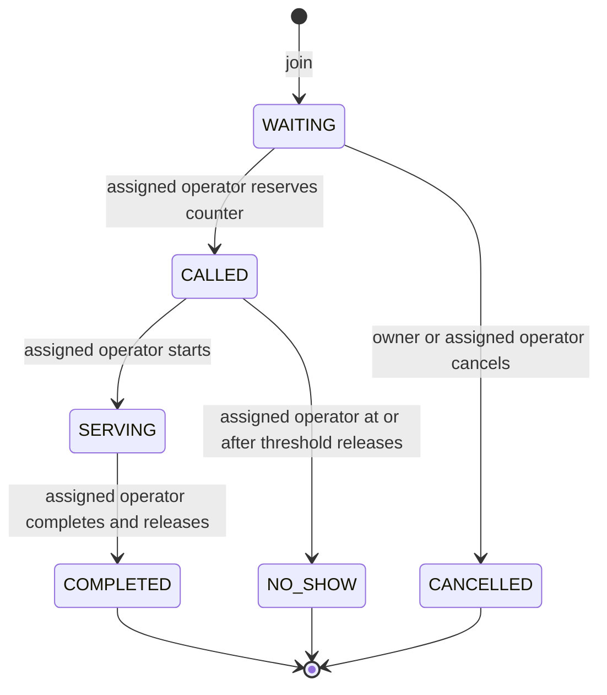
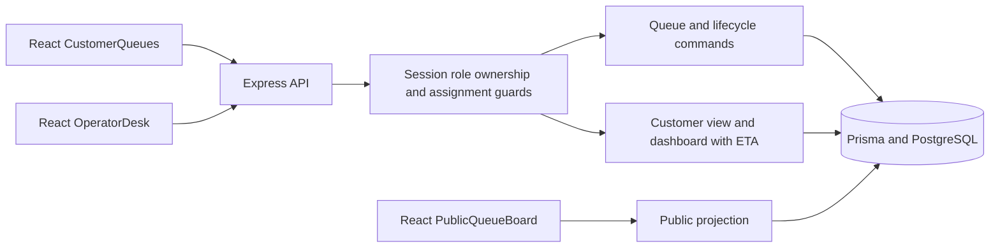
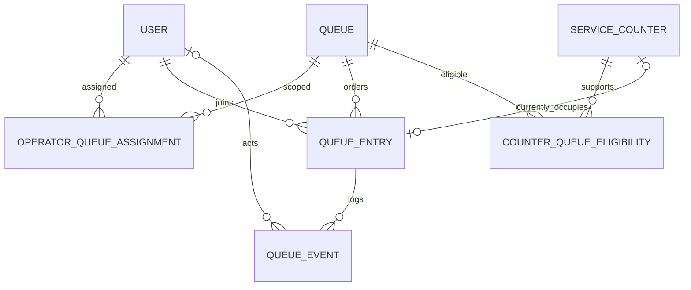
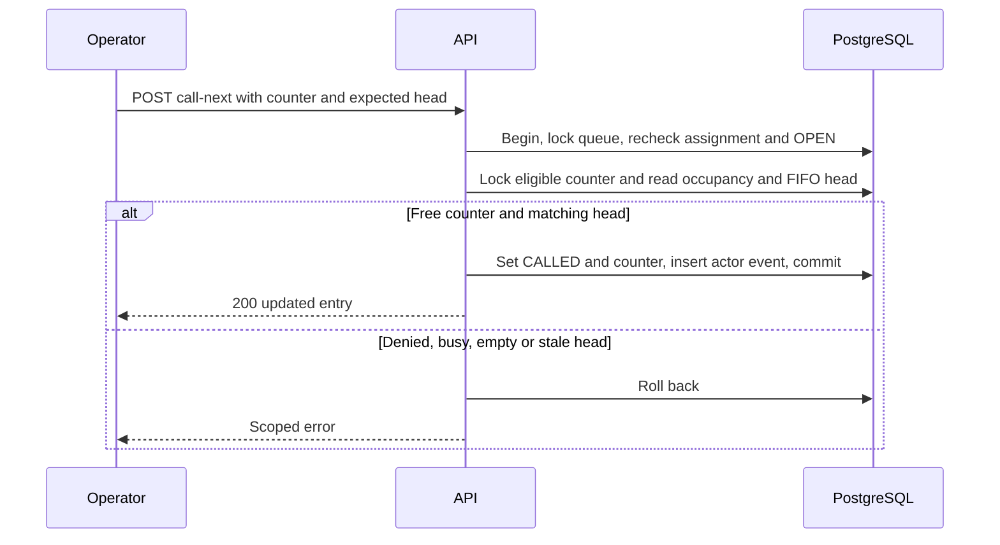
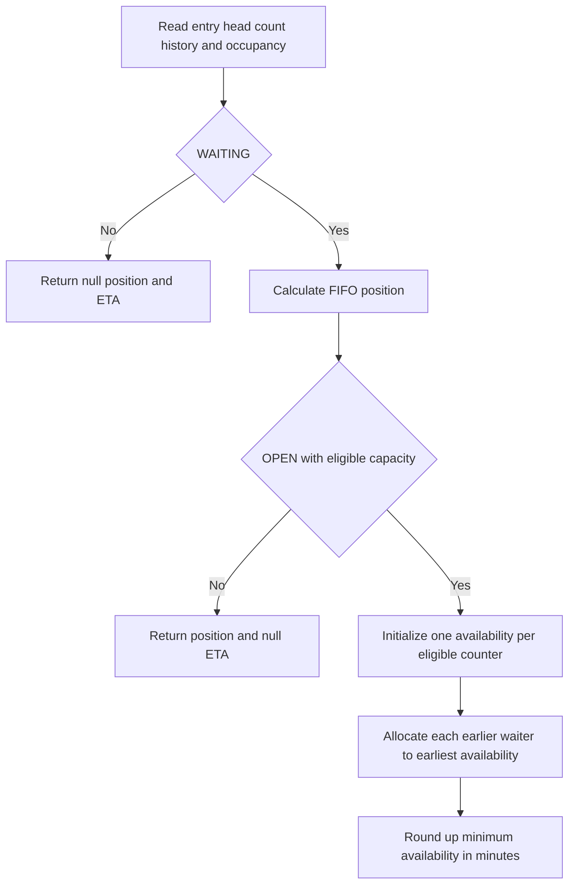

# Sprint 2 engineering specification

> NaiCha · CPE334 Theme 9 · 28 November 2026 (Asia/Bangkok) · Sprint 2 Engineering Contracts · Target `sprint-2`

[API](api-spec.md) · [UI](ui-spec.md) · [STS](tests.md) · [Issue #17](https://github.com/Kerris812/CPE334_FinalProject/issues/17)

## Part A — Software requirements specification

### Scope and maintained baseline

F-06 through F-10 extend the existing React, Express and PostgreSQL system. Preserve authentication, server roles and queue assignments, shared A/B access to R and S, cross-operator handoff, OPEN-only joins/calls, R for parties 1–4 and S for 5–8, FIFO by immutable per-queue sequence, one active entry per customer across both queues, unique immutable display numbers, transactional persistence and actual-actor auditing. Own-entry reads remain private. The anonymous board retains its legacy scalar fields and WAITING-only count. The board also lists active entries using public-safe fields. Queue administration, priority, reporting, notifications, reservations, counter administration and automatic no-show processing are outside this increment.

| FR | Required outcome |
| --- | --- |
| FR-08 | Preserve the privacy-safe anonymous board and WAITING-only count. Include an additive active-entry list with only display number, counter label and service state. |
| FR-13 | Owner or assigned operator may cancel WAITING. Persist cancellation time, actor and operator reason atomically. |
| FR-14 | Assigned operator may manually mark an overdue CALLED entry NO_SHOW and release its counter atomically. |
| FR-15 | See and act on all assigned queues in one dashboard, with independent waiting counts, all active entries and counter state. |
| FR-16 | Keep independent R/S queue ordering and persist compatible counter assignments. Allow simultaneous same-queue service with exclusive counter occupancy. |
| FR-17 | Show private WAITING position and a capacity-aware, clearly labelled ETA, plus next-waiting ETA on the authorized operator dashboard. |
| FR-09–12 | Call reserves a counter. Start preserves it, complete releases it, and each lifecycle mutation is audited as the authenticated actor. |
| FR-22/24 | Refresh and recover safely from stale/conflicting data. Migrate and provision reproducibly and preserve durable state. |

| Rule | Sprint 2 contract |
| --- | --- |
| BR-01/02/06 | Call the lowest sequence currently WAITING in the selected OPEN queue. No priority or cross-queue FIFO. |
| BR-04/05 | WAITING, CALLED and SERVING are active for customer uniqueness. All three terminal states permit another join subject to normal rules. |
| BR-07 / BR-20 | A counter holds at most one CALLED or SERVING entry across all eligible queues. Each CALLED or SERVING entry must hold exactly one eligible counter. Other statuses hold none. Call reserves, start keeps, complete/no-show releases. Two different counters may serve the same queue simultaneously. |
| BR-08/26 | Legal service and termination edges are exactly those in the diagram. COMPLETED, CANCELLED and NO_SHOW are immutable terminal states. |
| BR-09–14/28 | Existing role, assignment, session, origin and privacy checks apply on the server. A customer can act only on their own entry. An operator must have current assignment to the target queue and the counter must be eligible for that queue. Handoff does not depend on past actors. |
| BR-16/17 | Guard source status and occupancy in the transaction. Every successful edge adds exactly one event with actual actor, from/to, entry and server occurrence time. Failures leave entry, occupancy and events intact. |
| BR-18 | Cancel only WAITING. Operator reason is required, trimmed, single-line, 1–200 Unicode code points with no control characters. Customer submits no reason. |
| BR-19 | Manual no-show only from CALLED with non-null calledAt and server action time at least 300,000 ms later, inclusive. Starting service ends eligibility. Crossing the threshold permits a manual action and leaves the counter occupied until an authorized release commits. |
| BR-21 | A numeric ETA is a non-negative estimate of time until call, provided only for WAITING when queue and counter capacity permit calculation. |

| Permission | Customer | Assigned operator | Other operator | Anonymous |
| --- | --- | --- | --- | --- |
| Own entry/position/ETA | Own only | Denied | Denied | Denied |
| Cancel WAITING | Own only | Target queue, reason required | Denied for unassigned queue | Denied |
| Call/start/complete/manual no-show | Denied | Target queue and eligible counter | Denied for unassigned queue | Denied |
| Dashboard | Denied | Assigned queues and eligible counters | Own scope, or empty | Denied |
| Public board | Public projection | Public projection | Public projection | Public projection |

NFR-01/04/13 preserve identity and least-privilege DTOs, safe error messages and durable auditing. NFR-05/06 require no invariant violations under concurrent writes, restart or migration and rollback on audit failure. NFR-08 requires deterministic ETA for a fixed snapshot and clock. NFR-09/10 require keyboard operation and no horizontal page scroll at 320 CSS px. NFR-14 requires gated deploy and persistence verification. NFR-15 requires a fresh snapshot after writes/conflicts before enabling affected controls. Dependencies include CR-L7-01 provisioning, PostgreSQL row locks and constraints, existing session/origin middleware, and a controlled migration window.

### Numbered acceptance criteria

| Criterion | Observable result |
| --- | --- |
| S2-F06-AC-01 | Owner cancellation returns CANCELLED, persists one actor/time event and permits a fresh join with a new number. Operator cancellation does the same with a persisted trimmed reason. |
| S2-F06-AC-02 | Foreign, wrong-role, unassigned, invalid-reason, CALLED, SERVING and terminal requests fail with the API codes and leave state/events unchanged. A call/cancel race permits at most one transition of that entry. |
| S2-F07-AC-01 | Server rejects at +299,999 ms and accepts fresh CALLED fixtures at +300,000 and +300,001 ms. Success adds one actual-actor event and releases only its counter. |
| S2-F07-AC-02 | Unauthorized, wrong-state, missing-call-time and repeated requests produce no writes. Start/no-show race commits one edge. Passage of time alone changes no persisted state. |
| S2-F08-AC-01 | One dashboard shows all assigned queues, WAITING-only totals, all active entries and accurate occupancy. Unassigned queues and private occupant details stay hidden. Revoking one assignment removes that queue from subsequent reads and denies actions from the same session. |
| S2-F08-AC-02 | Counters and lifecycle controls reflect server state. Success and conflicts refresh the snapshot. Loading, empty, error, responsive and keyboard paths follow UI specification. |
| S2-F09-AC-01 | While A serves R-0001 at Counter 1, B can call and serve R-0002 at Counter 2. Repeat independently for S. Either operator may finish the other's service. The board lists both active entries using only the public field allowlist. |
| S2-F09-AC-02 | Same-counter requests and same-preview requests have a single winner. Two eligible independent reservations serialize FIFO. PostgreSQL rejects duplicate occupancy, invalid linkage and active status without a counter. An audit insert failure rolls back a call and its reservation. |
| S2-F09-AC-03 | Complete releases only its counter. Assignment, eligibility, numbering and audit history survive restart, migration and repeat seed. An invalid backfill fails without partial changes. An audit insert failure during completion leaves the counter occupied. |
| S2-F09-AC-04 | Unassigned queue and ineligible counter requests are rejected without writes. Closed/paused queues reject new calls. Shared counter contention across queues cannot double-book. |
| S2-F10-AC-01 | WAITING position and ETA match the documented formula for deterministic data, including fallback, all-busy, free, overrun and no-capacity cases. |
| S2-F10-AC-02 | Customer and operator views show labelled estimates and refresh after cancel, call, no-show and complete. Non-WAITING/empty views omit numeric estimates. Foreign and public reads expose no ETA inputs. |

## Part B — Feature inventory

| Feature | Requirements | Dependencies | Baseline or target |
| --- | --- | --- | --- |
| F-01 Authentication | FR-01 | Users, sessions | Maintained release behavior |
| F-02 Authorization, setup, health | FR-02–04/23/24 | F-01, DB | Maintained with CR-L7-01 shared assignments, F-09 extends seed |
| F-03 Join and numbering | FR-05/06 | F-01/02 | Maintained, terminal cancellations/no-shows allow rejoin |
| F-04 Private status and public board | FR-07/08 | F-01–03 | Maintained privacy, F-10 adds private fields, F-09 orders the public scalar deterministically and adds an active-entry list |
| F-05 Service lifecycle | FR-09–12 | F-01–04 | Lab 7 handoff maintained, capacity and action projections revised under F-09 |
| F-06 Cancellation | FR-13 | F-03/05 | Planned, #18 |
| F-07 Manual no-show | FR-14 | F-05/09 | Planned, #18 |
| F-08 Dashboard | FR-15/22 | F-05–07/09 | Planned, #20 |
| F-09 Counters | FR-16/24 | F-02/05 | Selected scope, implementation planned in #19 |
| F-10 Waiting experience | FR-17 | F-04/05/08/09 | Planned, #20 |

## Part C — System-level SDS

Existing flow is React/Vite → Express API (session and role middleware, queue/entry ownership or assignment guards) → queue/operator/public services → Prisma and PostgreSQL. Queue writers lock the queue, join also locks the customer first, and the current PostgreSQL partial queue index enforces one service slot. The desk returns a scalar active entry. The board is a repeatable-read snapshot. See [Sprint 1 Part C](../sprint-1/specification.md) and [Lab 7 system SDS](../lab7/system-sds-revision.md).

**Persistence.** Add `service_counters(id UUID, code UNIQUE, name)` and `counter_queue_eligibility(queue_id, counter_id)` with a composite primary key and restrictive FKs. Add nullable `queue_entries.counter_id` with a composite FK `(queue_id, counter_id)` to eligibility. Add a CHECK requiring counter_id exactly in CALLED/SERVING and a unique partial index on non-null counter_id. A single column precludes multiple assignments per entry. Derive occupancy from the linked entry, with no separate mutable flag. Existing `cancelledAt`, `noShowAt`, event reason and terminal enum values are already in schema. Add a nullable event counter FK for new CALLED/STARTED/COMPLETED/NO_SHOW events, recording the counter before release. Leave legacy events intact. Keep immutable sequence/number enforcement and the active-customer partial index.

**Writer isolation.** Use PostgreSQL READ COMMITTED. Resolve stored queue identity for entry actions, lock the queue row first, revalidate actor and scope and hold the operator assignment through commit. Customer cancel locks its own user row before queue as join does. Call then locks the selected eligible counter row and rechecks availability in a subsequent statement after lock acquisition. Entry actions re-read stored status and counter under the queue lock, lock that counter where applicable, then perform a guarded update. For legacy calls with no selection, lock eligible counters in stable code order and choose first currently free. All counter writers take queue before counter, counter locks in code order when plural, and never acquire another queue after a counter. Operator paths need only read user state and hold assignment scope, with no customer-row lock. This permits concurrent service across requests and serializes competing claims, including across R/S on a shared counter. FIFO means committed assignment order, independent of HTTP response order. For stale preview, compare expected entry to fresh FIFO head. Never skip a locked FIFO head. Constraints provide a final check against duplicate occupancy. Commit entry, timestamps, occupancy and audit together. Roll back on error, translating known conflicts per API.

**Read isolation.** Fetch dashboard (including history and head ETA), private entry and ETA, desk and public board as separate, internally consistent repeatable-read snapshots. Capture one server as-of time per read. Filter queues by assignments in that snapshot. For a shared counter occupied by an unassigned queue, report busy with occupant null. Compatible desk and board scalar projections use lowest active sequence. The public count always counts WAITING only. The scalar board cannot show a second active number even when two counters serve the queue. Read all active entries for the requested queue in ascending sequence from the same snapshot. Project only displayNumber, counterLabel and serviceState per entry, using the configured public counter name as the label. The UI supports scalar-only responses from legacy servers.

**Migration and rollout.** Back up PostgreSQL and rehearse on a representative clone. Stop old writers and exclude mixed-version write traffic. Preflight that all active legacy rows belong to configured eligible queues, capacity covers them and CALLED/SERVING timestamps required for ongoing actions exist. In one transactional migration create configuration, backfill R→C1 and S→C2 for existing CALLED/SERVING entries, verify coverage, install constraints and remove `queue_entries_one_service_slot` last. Preserve existing numbers, timestamps, event history, assignments, sessions and WAITING/terminal rows. Abort on unexpected records or constraint failure. Provision stable counter codes and eligibility idempotently without reset or duplicate rows. Verify counts/IDs, constraints, baseline authentication/board smoke, and restart persistence before opening traffic. Follow [Lab 5 rollout and recovery](../labs/lab-05/deployment.md). A Cloud Run traffic rollback alone cannot reverse this migration. After cutover use a compatible build or an approved DB restoration/reconciliation plan. Once parallel service exists, the old one-slot model cannot accept that live state without reconciliation.

**Unaffected components.** Authentication endpoints, session storage, role model, party routing, queue codes, join endpoint contract, queue numbering trigger, health endpoint and legacy public board fields are reused.

## Part D — Change and approval record

| Evidence / decision | Finding and status |
| --- | --- |
| Starting tree | Clean `feature/17-sprint2-engineering-contracts` at `1a44362ba238b03af65a55028ff685231f79b52a`, matching local `sprint-2`, `main` and their remote-tracking refs. |
| Sprint 1 | `v0.1.0` resolves to `f5b47ba99d3b7864460f3a27bbf85306a9fb67ad` (PR #30 release). `sprint1-uat-baseline` resolves to `fc178ed639619e3e74a37724a0373e990839a0e8`. Historical Lab 7 notes also reference `92125c4` for Lab 6. Formal Sprint 1/Lab 6 acceptance remains unverified. [Release verification](../sprint-1/release-verification.md) · [Lab 7 version record](../lab7/README.md#2-version-record-and-verification-limits) |
| Lab 5 | §31 records gated automated CD run 44569135629 for `fc178ed`, with deployment and smoke verification. §32 leaves before/after record and session continuity, recovery and screenshot evidence pending. Serving revision/digest and current deployment were not independently verified here. |
| Lab 6 | `1f2bc81` intentional defect and `af2e357` correction appear in isolated Lab 6 history at `478212e`. The correction commit is outside HEAD ancestry. HEAD independently has the correct WAITING-only count and API regression assertions in `server/tests/api/public-board.test.ts`. Current Sprint 2 execution is pending. |
| CR-L7-01 | [Lab 7 revision 1.1.0](../lab7/README.md) records TA Prapatsorn Sangrod's approval on 23 November 2026. Source approval attachment and teammate contract sign-off remain unverified. `1bd6d75` contracts, `332dffb` shared provisioning, `75a1ff3` maintenance tip and `1a44362` integration establish maintained repository state. [Phase 2 evidence](../../artifacts/evidence/lab7/phase2/phase2-summary.txt) records historical working-tree runs, including 23 focused API, 123 total API, 79 UI and two handoff E2E passes. Those runs do not verify HEAD, deployment or Sprint 2. |
| Previous F-09 | Sprint 1 D-07/D-26, FR-16 and feature inventory deferred persistent multiple counters per queue to Sprint 2. Issue nickname “multiple queues” describes scope already delivered for R/S. |
| Revised F-09 | Explicitly replace Lab 7's queue slot with counter occupancy so one operator's active service does not block a second operator with an eligible free counter. Preserve R/S and handoff. |
| Counter configuration | Two shared counters in total across the restaurant, C1/Counter 1 and C2/Counter 2. Both are eligible for both R and S, and either queue can use both at once. A/B may choose either free counter for an assigned queue and hand off service to one another. No fixed operator-to-counter ownership. |
| Public projection | Keep legacy scalars and WAITING-only counts. The additive activeEntries array displays simultaneous service while limiting each item to display number, counter label and service state. |
| UX, ETA and API decisions | The contract selects the Part E ETA parameters and shared-capacity approximation, the BR-18 cancellation reason rules, and the backward-compatible call, desk and board API projections. See Parts C/E and the companion specifications. |
| Sprint 2 review | Both teammates must review and sign off on Issue #17 before feature implementation. Sign-off is pending. |

**Impact and observed differences.** The existing schema contains terminal values and timestamps but the transition helper exposes only the service chain. There is no counter table, cancellation/no-show command, customer position or ETA. Desk reads one active entry and UI blocks all further calls until it clears. Public board currently does a scalar active lookup without ordering, safe under the single-slot invariant. Update D-07/D-26, FR-07–17/22/24, BR-07/08/16/17/19–21/26/28 and affected NFR evidence. Replace queue-idle and one-winner-per-queue assumptions in L7-FR-02/04/07, L7-PR-01/03, L7-AC-07/11 and impacted Sprint 1/Lab 7 cases in Part F. Preserve separate queue order, shared assignments and actual actor. Change operator service, projections, lifecycle helper, Prisma/migration/seed and operator/customer UI in implementation issues. The legacy board shows only the lowest-sequence active entry, so simultaneous service can be hidden from customers. The array shows all active numbers in the requested queue while keeping the scalar selection rule. BR-12 still prohibits customer identities, private IDs, audit actors and reasons.

**Issue routing.** [#17 contracts](https://github.com/Kerris812/CPE334_FinalProject/issues/17), [#18 F-06/F-07](https://github.com/Kerris812/CPE334_FinalProject/issues/18), [#19 F-09](https://github.com/Kerris812/CPE334_FinalProject/issues/19), [#20 F-08/F-10](https://github.com/Kerris812/CPE334_FinalProject/issues/20), [#21 integration and release](https://github.com/Kerris812/CPE334_FinalProject/issues/21). #18 may design cancellation independently, but integrate no-show release with #19 before merging the end-to-end feature. #20 consumes both contracts. #21 records executed commands, SHAs, evidence and release approval. No separate tracked Sprint 2 contract directory was present before this work.

## Part E — Feature-level SDS

All commands use the identity, transaction, error handling and atomic audit conventions in [Part C](#part-c--system-level-sds) and the [API](api-spec.md). All features are done when their linked acceptance cases, affected baseline regressions and implementation review are recorded in #21.

### F-06 — Cancellation management

**Requirements and actors.** FR-13, BR-04/08/10/11/16–18/26. Customer owns the stored entry. Operator is scoped to its stored queue and must enter a reason. Target must be WAITING.

**Success and side effects.** Confirm in the private customer view or dashboard, then POST the role-specific cancellation route. Lock customer and queue in join order for an owner request, or lock queue and hold operator scope for a staff request. Re-read WAITING, set CANCELLED and cancelledAt and insert CANCELLED event with the actual actor, previous state and trimmed reason for staff. Customer event reason is null. No occupancy is implicated. Return updated entry and refresh. New joins obtain a new number through the existing path.

**Alternatives.** Denial, invalid reason, stale state and repeat use the documented errors. A call/cancel race resolves under the queue lock, with no write from a failed edge. Audit failure rolls back cancellation. Keep the reason private in audit storage and render UI input as plain text.

**Dependencies and completion.** F-03/F-05 entry ownership, state and audit. S2-F06-AC-01/02. Done when both role-specific controls and routes demonstrate rejoin, invalid-state handling and audit rollback.

### F-07 — Manual no-show

**Requirements and actors.** FR-14, BR-07/08/11/16/17/19/20/26. Assigned operator acts on a CALLED entry with a stored counter. The same counter may have been reserved by another operator.

**Success and side effects.** Dashboard computes the earliest action time from calledAt and asks for confirmation. POST no-show. Lock queue then stored counter, check state and sample the server action clock after locks. Compare elapsed time at millisecond precision using the same timestamp for noShowAt and the event. Atomically write NO_SHOW, clear counter and append NO_SHOW event storing counter and actual actor. Refresh all dashboard counters and customer status.

**Alternatives.** A missing calledAt is an invalid transition. Before threshold return NO_SHOW_TOO_EARLY. A repeat, simultaneous start or wrong source status returns INVALID_TRANSITION for the losing edge. Expiry enables a manual action, with no automatic write or release. Refuse inconsistent stored occupancy as an internal invariant failure.

**Dependencies and completion.** F-05 audit/state and F-09 occupancy. S2-F07-AC-01/02. Done when the boundary, race, isolation and handoff audit cases are verified.

### F-08 — Unified operator dashboard

**Requirements and actors.** FR-15/22, BR-07/11/16/18–20/28. Authenticated operator can load assigned queues and eligible counters. No assignments yields a successful empty snapshot.

**Workflow.** GET dashboard, render R/S sections and a shared set of counter cards. Show FIFO waiting list, next waiting ETA, counts and every active customer in scope. Select queue and eligible free counter, then submit displayed head ID with Call Next. Start/complete target the entry on its persisted counter. Cancel any listed WAITING entry and mark an eligible CALLED entry no-show via the confirmation paths. Show the outcome and refresh the whole snapshot after each action, including assignments and shared occupancy.

**Data and failure.** Snapshot service reads assignments, counters, entries and history in one repeatable-read transaction. Writes delegate to F-05/06/07/09. A shared counter busy outside operator scope carries no occupant identity. Stale preview, revoked access and stale action status trigger the safe refresh and authorization behaviors in the [UI](ui-spec.md).

**Dependencies and completion.** F-05–07, F-09, and the F-10 estimator. S2-F08-AC-01/02. Done when A/B can use one accessible dashboard on both screen sizes and scoped, stale and empty states are tested.

### F-09 — Service counters

**Requirements and actors.** FR-09–12/16/24, BR-01/02/06/07/11/16/17/20/28. Assigned operator chooses an eligible free counter for an OPEN queue with a WAITING head. Part D defines the C1/C2 configuration.

**Lifecycle.** Start retains the assignment. Complete and manual no-show capture its counter in the event and release only that assignment. A counter occupied by R is also busy for S under the shared eligibility policy in Part D. Two requests specifying the same preview on different counters cannot silently consume successive entries. A queue-only legacy request calls the fresh head using the lowest free counter. Independent counter reservations using separate fresh heads remain legal. On simultaneous unconditioned calls success follows serialized FIFO.

**UI and failure.** Select a free counter against a queue with WAITING entries. The server makes the final eligibility and availability determination and UI refreshes on conflict. All database writes, migration and provisioning follow Part C.

**Dependencies and completion.** F-02 scope and seed, F-05 lifecycle, #19 migration before combined F-07 release. S2-F09-AC-01–04. Done when invariants, same-queue concurrency, cross-queue contention, migration and restart are verified.

### F-10 — Customer waiting experience

**Requirements and actors.** FR-07/15/17, BR-01/10/11/12/21. Owner reads own entry, operator reads next WAITING ETA per assigned queue, public projection stays restricted. Estimate indicates elapsed time until call from server as-of, measured in rounded-up whole minutes.

**Deterministic estimator.** Use one as-of clock and database snapshot. Position is 1 plus smaller-sequence WAITING entries in the same queue. For service duration D in ms, select up to 20 most recent valid same-queue COMPLETED rows at or before as-of, sorted completedAt descending then ID ascending. Valid duration is positive completedAt minus servingAt. Use arithmetic mean of valid durations if at least five exist, otherwise D = 600,000 ms. Calculate D separately for each queue represented by busy eligible counters, using its completed history internally. Do not expose those inputs.

For each eligible counter, initialize availability as follows.

| Occupancy | Availability in ms |
| --- | --- |
| Free | 0 |
| SERVING | max(0, D for occupant queue − max(0, as-of − servingAt)) |
| CALLED | D for occupant queue + max(0, 300,000 − max(0, as-of − calledAt)) |

For each earlier WAITING entry in sequence order, add target queue D to the counter with smallest availability, breaking ties by counter code. ETA is ceil(minimum remaining availability / 60,000). For missing legacy occupant timestamps use elapsed zero. Non-WAITING has null position and ETA. WAITING in a non-OPEN queue or without eligible counters retains position with null ETA. Example with no history, two free counters and position 3 yields 10 minutes. With one SERVING for 4 minutes and one CALLED for 2 minutes, position 1 yields 6 minutes. The model estimates existing commitments and same-queue predecessors. The 300,000 ms term estimates time remaining in the minimum no-show interval and does not predict a counter release. At the threshold the CALLED entry still occupies its counter. It stays occupied until a manual no-show or until service is started and then completed. Operator action timing, shared-counter allocations and service overruns can change the estimate.

**Refresh and failure.** Compute ETA on the server for each customer latest/detail read, using one as-of time captured for its database snapshot and no writes. Refresh immediately after successful customer join/cancel, after operator actions for the dashboard, and on the customer’s next visible 10-second poll or visibility return for actions by others. The browser renders server estimates without a local countdown. UI labels the ETA as approximate and shows unavailable when calculation has no capacity. A stale value is identified as such and a foreign lookup returns 404.

**Dependencies and completion.** F-04 ownership, F-09 capacity and F-08 projection. S2-F10-AC-01/02. Done when deterministic fixtures and real customer/operator journeys cover the calculation, refresh and privacy.

## Part F — Requirements traceability and regression

Feature criteria below use the full IDs from Part A. Every S2-TEST ID resolves to the [STS](tests.md). Issue #17 owns the contracts and #21 owns integrated execution for every row.

| Feature | FR | BR | Acceptance criterion | Design | API / UI | Test IDs | Implementation issue |
| --- | --- | --- | --- | --- | --- | --- | --- |
| F-06 | FR-13 | BR-04/17/18 | S2-F06-AC-01 | Owner/staff command and audit | Both cancel routes, confirm and rejoin | S2-TEST-01, S2-TEST-02, S2-TEST-26 | #18 |
| F-06 | FR-13 | BR-08/10/11/16/18/26 | S2-F06-AC-02 | Scope guards, validation and lock | Both cancel routes, reason field | S2-TEST-03, S2-TEST-04, S2-TEST-05 | #18 |
| F-07 | FR-14 | BR-07/17/19/20 | S2-F07-AC-01 | Clock and release | No-show, countdown | S2-TEST-06, S2-TEST-26 | #18, #19 |
| F-07 | FR-14 | BR-08/11/16/19/26 | S2-F07-AC-02 | Guarded lifecycle | No-show, start-service | S2-TEST-07, S2-TEST-08 | #18, #19 |
| F-02/08 | FR-02/03/15 | BR-07/11/12/20/28 | S2-F08-AC-01 | Scoped snapshot and assignment recheck | Dashboard, desk and operator actions | S2-TEST-09 | #20 |
| F-08 | FR-15/22 | BR-16/18–20/28 | S2-F08-AC-02 | Resource controller and action dispatch | Dashboard and operator mutations | S2-TEST-10, S2-TEST-11 | #20 |
| F-04/05/09 | FR-08–12/16 | BR-01/02/07/12/17/20 | S2-F09-AC-01 | Reservation, lifecycle, public scalar and active list | Call-next, start-service, complete, board | S2-TEST-12, S2-TEST-24 | #19 |
| F-05/09 | FR-09/16 | BR-01/02/07/16/17/20 | S2-F09-AC-02 | Locks, preview, constraints and audit rollback | Call-next and picker | S2-TEST-13, S2-TEST-14, S2-TEST-15, S2-TEST-16, S2-TEST-27 | #19 |
| F-09 | FR-11/16/24 | BR-05/07/17/20 | S2-F09-AC-03 | Completion, migration and provisioning | Desk, complete and dashboard | S2-TEST-17, S2-TEST-18, S2-TEST-27 | #19 |
| F-09 | FR-09/16 | BR-06/07/11/16/20/28 | S2-F09-AC-04 | Eligibility and OPEN guard | Call-next and picker | S2-TEST-19, S2-TEST-20 | #19 |
| F-04/10 | FR-07/17 | BR-01/10/21 | S2-F10-AC-01 | Snapshot estimator | Customer reads and wait panel | S2-TEST-21, S2-TEST-22 | #20 |
| F-04/08/10 | FR-07/08/15/17/22 | BR-10–12/21 | S2-F10-AC-02 | Scoped projections and refresh | Customer reads, dashboard and board | S2-TEST-23, S2-TEST-24, S2-TEST-26 | #20 |

### Baseline traceability and changes to verification

Carry forward the original [Sprint 1 Part B matrix](../sprint-1/specification.md) and [Lab 7 STS traceability](../lab7/sts-revision.md), including original issue links and historical results. The table below identifies where Sprint 2 execution retains or revises those assertions. Existing DB fixture factories that directly insert active entries must assign eligible counters. Keep historical tests and evidence at their original commits.

| Feature / requirement | Prior criteria and tests | Sprint 2 verification |
| --- | --- | --- |
| F-01/02 · FR-01–04/23/24 · BR-09/11/13/14/28 | AC/TEST-001–015, L7-AC-01/12–15 and corresponding Lab 7 cases | Retain auth, role, true unassignment, health and repeat provisioning. Use shared A/B seed expectations. Carry forward L7-007 with S2-TEST-09, including revocation with a live session. Extend seed and restart with S2-TEST-17/18/25. |
| F-03 · FR-05/06 · BR-03–06/15/27 | AC/TEST-016–024, L7-AC-10/13/15 | Retain routing, joins, sequence and cross-queue duplicate prevention. Strengthen TEST-019/020 with a simultaneous R/S join by one customer in S2-TEST-25. Add cancellation rejoin in S2-TEST-01/02 and repeat join after NO_SHOW in S2-TEST-23. |
| F-04 · FR-07/08/22 · BR-10/12 | AC/TEST-025–031 | Retain owner/foreign access and the legacy public field allowlist. Verify the extended list against its separate allowlist in S2-TEST-24. Revise exact private DTO tests for additive nullable fields. Extend board occupancy and WAITING-only assertions with S2-TEST-23/24. |
| F-05 · FR-09–12 · BR-01/02/06/08/09/11/17/26/28 | AC/TEST-032/033/035–039/041–044; L7-AC-02–06/08/09/12–14 | Retain valid service order, terminal immutability, OPEN guard, distinct actors and FIFO. Supply compatible counters. Update operator desk mocks/journeys, replace queue-selector and 0/1 assertions with both queue sections and per-counter state. Add S2-TEST-10/11/12/19. |
| F-05/09 · FR-09/16 · BR-07/16/20 | AC/TEST-034/040, TEST-056, L7-AC-07/11 and L7-011/015 | Revise single-slot and one-winner-per-queue assertions to explicit same-counter contention. Test both independent counters and cross-queue shared contention. Revise stress variants to pin the same counter or assert capacity-bounded successes in FIFO order. S2-TEST-12–16/20. |
| F-05/08/09 · FR-11/12/15/16/22 | TEST-043/057, L7-005/010/018/019/020 | Keep handoff, audit atomicity and independent-queue lock checks. Use distinct counters for independent-queue tests. Replace selected-queue stale desk assumptions with scoped dashboard refresh and entry-specific controls. S2-TEST-08/10–12/17/27. S2-TEST-27 extends TEST-041 and L7-020 with rollback assertions for counter reservation and release. |

Affected executable suites include `operator-workflow.test.ts`, `party-routing.test.ts`, `lab7-regression.test.ts`, `queue-views.test.ts`, `public-board.test.ts`, operator desk and Lab 7 UI suites, and the operator workflow, party routing, Sprint 1 and Lab 7 browser journeys. Keep baseline unit routing and numbering assertions. Extend lifecycle unit fixtures for the new legal edges, and invert only the old assertion that those named edges are unavailable.

### Issue #17 review checklist

| Criterion | Review readiness |
| --- | --- |
| S2-AC-001 | Parts A–E and companion API/UI cover all five features. |
| S2-AC-002 | Shared Lab 7 scope and actual-actor handoff specified and carried into tests. |
| S2-AC-003 | Part D records the selected F-09 scope and rationale. |
| S2-AC-004 | Part A defines permissions, rules and state graph. |
| S2-AC-005 | Part F maps all feature acceptance criteria to planned STS cases. |
| S2-AC-006 | Part F carries forward Sprint 1 and Lab 7 traceability and records revisions. |
| S2-AC-007 | Contracts finalized for teammate review. Both teammates’ sign-off on Issue #17 is pending. |

Reviewers should check the Part D decisions, walk through same-counter contention, same-head races and shared-counter ETA, and check the migration/rollback boundary against real deployment assumptions. Record both teammates’ sign-off on #17 before feature implementation. After review, commit the four documents for integration into `sprint-2`.
